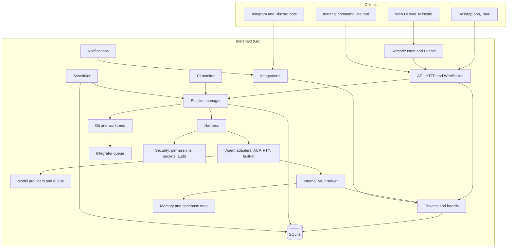
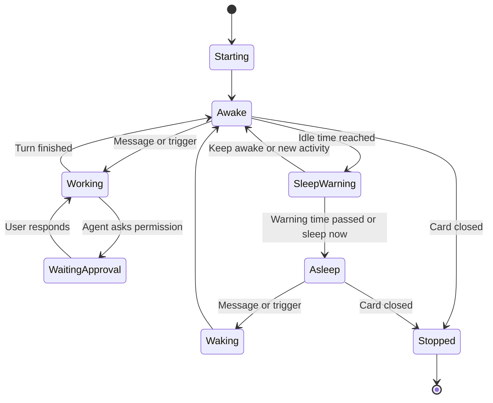
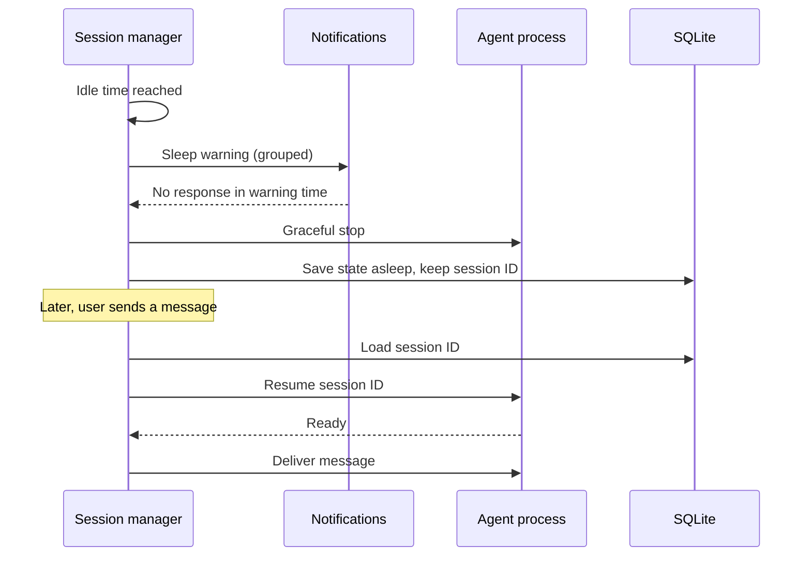
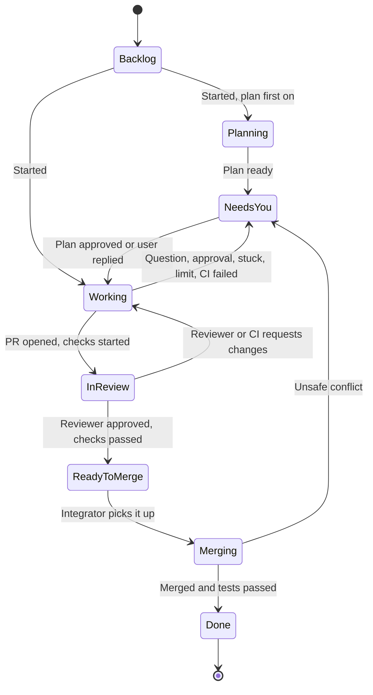
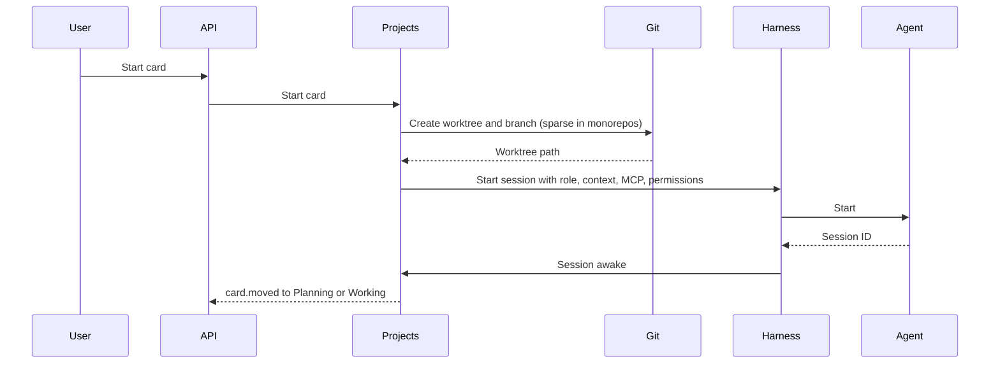
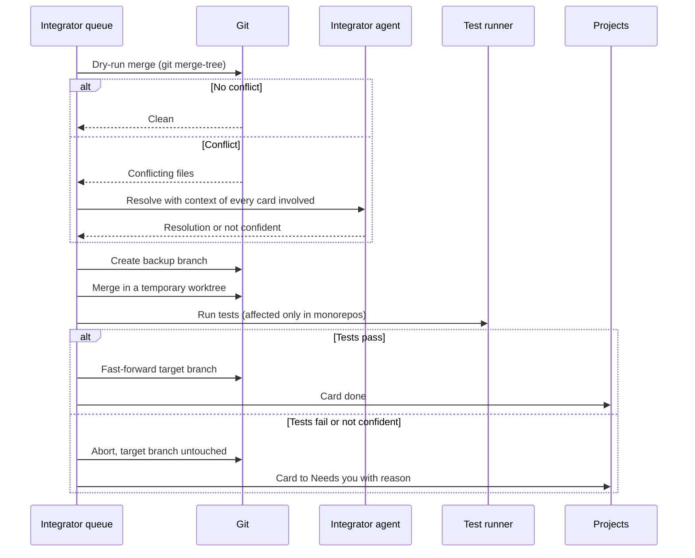
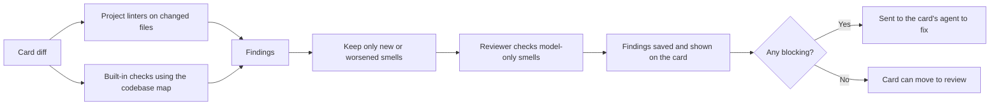

# Architecture

This document explains how Marshal is built: its parts, how they talk, where data lives, and the rules that keep it light and safe. Read it before changing any module.

---

## 1. System at a glance

Marshal has three layers:

1. **Clients** show things and send user actions. They hold no business logic.
2. **The daemon** (`marshald`) owns all state and does all work.
3. **Agents and external services** do the coding and hold outside data.



### Why this shape

- **Agents keep running when the UI is closed**, because the daemon owns them, not the window.
- **One daemon serves every client:** the desktop app, the web UI, the command line tool, and chat bots all use the same API.
- **The UI stays small**, because it only renders state and sends actions.

---

## 2. Processes

| Process | Language | Lifetime | Job |
|---|---|---|---|
| `marshald` | Go | Runs as a user service, starts at login | Owns all state and work |
| Desktop app | Rust shell (Tauri) + SolidJS | Runs while open | Shows the UI |
| `marshal` | Go (same module, separate binary) | Runs per command | Thin client for scripts and terminals |
| CLI agents | Third party | One per awake card | Do the coding |

### Daemon as a user service

The daemon is installed as a per-user service, so it keeps running when the desktop app is closed. `marshal service install` installs `marshald` (`marshal service uninstall` and `marshal service status` remove it and check it); `--dev` installs the dev daemon as its own separate service, so it can run beside a normal install:

- **macOS:** a per-user launchd agent (`~/Library/LaunchAgents/com.marshal.daemon.plist`, `com.marshal.daemon-dev.plist` for `--dev`), installed with `launchctl bootstrap gui/$UID`, falling back to the older `launchctl load -w` when bootstrap is not a recognized subcommand. It restarts on a crash (`KeepAlive`/`SuccessfulExit: false`) but not after a clean exit, so `marshal dev reset` and a deliberate stop are not looped.
- **Linux:** a systemd user unit (`~/.config/systemd/user/marshald.service`, `marshald-dev.service` for `--dev`), installed with `systemctl --user enable --now` after a `daemon-reload`, plus a best-effort `loginctl enable-linger` so it can start at boot without an active login session (a warning, not a failed install, if that one command lacks the privilege). `Restart=on-failure`.
- **Windows:** a per-user scheduled task through `schtasks.exe` (`ONLOGON`, `/RL LIMITED`, no admin elevation), since Windows has no per-user systemd or launchd equivalent.

Every external command these run goes through `internal/platform`'s own short admin-command runner (`os/exec`, bounded by a ten-second timeout, never a shell string) rather than `internal/proc`: these are one-shot management commands, not the long-lived, process-tree-managed children `internal/proc` is built for, and on Linux they need session variables (for example `DBUS_SESSION_BUS_ADDRESS`) that `internal/proc`'s environment allow-list does not pass through.

The desktop app checks the daemon on start. If it is not running, it starts it. There is only ever one daemon per user, enforced with a real, OS-held advisory lock on a file at `<data>/marshald.lock` (`flock` on macOS and Linux, `LockFileEx` on Windows), not a PID-file staleness guess: the operating system releases the lock on its own if the process dies, including a hard kill. The daemon acquires the lock before it opens its database or a listener; when the lock is already held, it exits with a distinct code (`exitAlreadyRunning`) instead of starting a second copy.

---

## 3. Daemon modules

All daemon code lives under `daemon/internal/`. Each module owns its own data and exposes a small Go interface. Modules talk through these interfaces and through the internal event bus, never by reaching into each other's tables.

| Module | Package | Owns |
|---|---|---|
| API | `api` | HTTP routes, WebSocket event stream, auth tokens |
| Event bus | `events` | In-process publish and subscribe between modules |
| Projects and boards | `projects` | Projects (create, rename, edit, remove), boards, cards, columns, filters, swimlanes, saved views, checklists, card members |
| Comments | `comments` | Card comments, attachments, links, mentions, and agent read markers |
| Chats | `chats` | Project chats: create, rename, archive, restore, delete, and their sessions |
| Accounts | `accounts` | User profile, paired devices, onboarding and tutorial progress |
| Dashboard | `dashboard` | Home dashboard summaries, charts, and the activity stream |
| Session manager | `session` | Session life cycle: start, send, sleep, wake, resume, stop |
| Harness | `harness` | Permissions, limits, retries, fallback, stuck detection, activity feed |
| Agent adapters | `agents/acp`, `agents/pty`, `agents/builtin` | Talking to each kind of agent |
| Providers | `providers` | Model API adapters, rate-limit queues, usage and cost |
| Git and worktrees | `gitx` | Worktrees, branches, sparse checkout, checkpoints, cleanup |
| Integrator | `integrator` | The merge queue and merge process |
| CI monitor | `ci` | GitHub Actions state and the CI fix loop |
| Scheduler | `scheduler` | Crons, intervals, one-time jobs, event triggers, loops, briefs |
| Internal MCP server | `mcpserver` | Tools agents use to see the board and talk to each other |
| Memory | `memory` | Knowledge base, lessons, card notes, vault sync, session search |
| Codebase map | `codemap` | Light index of files and symbols |
| Integrations | `integrations/github`, `trello`, `gcal`, `gmail`, `googlefiles` (Drive, Docs, Sheets, Slides), `telegram`, `discord` | Outside services |
| Notifications | `notify` | Routing, grouping, and delivery of notices |
| Security | `security/permissions`, `secrets`, `audit`, `keychain` | Permission checks, secret scanning, audit log, stored credentials |
| Remote | `remote` | tsnet node, Funnel routes, pairing |
| Preview | `preview` | Dev servers per card, screenshots |
| Quality | `quality` | Code smell checks on card diffs, smell profiles, findings |
| Store | `store` | SQLite connection, migrations, generated queries |
| Budgets | `budgets` | Self-measurement of RAM, CPU, and disk |

### Event bus

Modules publish events such as `card.moved` or `session.state_changed`. Other modules subscribe. The API module forwards selected events to connected clients over WebSocket.

- The bus is in-process. There is no external queue.
- Events are small structs. Large data (logs, diffs) is referenced by ID, never copied into events.
- `Publish` never blocks and never waits for a subscriber. It gives the event the next sequence number (1, 2, 3, and so on in each epoch, across all topics) and the time from the bus clock, then returns the number. Every subscriber sees events in sequence order.
- A subscriber follows a set of topics, or all of them, and can add and remove topics while subscribed.
- Each subscriber has its own bounded queues and one goroutine. There is no goroutine per event. An ordinary event queue holds 256 events. If it fills, the oldest ordinary event for that subscriber is dropped, the subscription reports `Lagged`, and the subscriber re-syncs from the store.
- Critical events (approvals, state changes) are never dropped. They have a separate queue of 1,024 events per subscriber. If even that overflows, the bus closes the subscription with the reason "closed for resync", and the consumer reloads from the store and subscribes again.
- The bus keeps the newest 2,000 events in a ring. A reconnecting client is replayed the events it missed from the ring, on the topics it follows, or told to reload: `SubscribeSince` subscribes and replays in one step, so no event falls between them. The rules for gaps, epochs, and resync frames are in section 11.5.
- The sizes are settings of the bus, so tests use small ones.

---

## 4. Agents

### 4.1 Adapter interface

Every kind of agent implements the same interface, so the harness treats them the same:

```go
type Agent interface {
    Start(ctx context.Context, spec StartSpec) (SessionHandle, error)
    Resume(ctx context.Context, sessionID string, spec StartSpec) (SessionHandle, error)
    Send(ctx context.Context, h SessionHandle, msg UserMessage) error
    Interrupt(ctx context.Context, h SessionHandle) error
    Events(h SessionHandle) <-chan AgentEvent
    Respond(ctx context.Context, h SessionHandle, r ApprovalResponse) error
    Stop(ctx context.Context, h SessionHandle) error
    Capabilities() Capabilities
}
```

`Capabilities` tells the harness what the agent supports: resume, loading a saved session, structured events, model switching, thinking modes, and MCP. It takes no handle, so it describes the latest session the agent started. Each `SessionHandle` also carries the capabilities its own session found, and which of the requested model, thinking mode, and permission mode the agent really took.

How the interface behaves (the same for every adapter):

- **Lifetime.** The context of `Start` and `Resume` only bounds the start. The session lives until `Stop` or until its process ends, so a request that ends does not kill the agent.
- **One turn at a time.** `Send` returns at once, and the turn ends with a `TurnEnded` event for an agent whose events are structured; a second `Send` while such a turn runs returns `ErrBusy`, and the session manager queues the message, but the PTY adapter (4.2) never sends `TurnEnded` and never returns `ErrBusy`, so the session manager never gates its `Send` on a turn ending. `Interrupt` stops the running turn and keeps the session, so the stop button in the UI does not lose the conversation. The turn then ends with `TurnEnded` and the reason `cancelled`.
- **Events.** One channel per session, closed after the last event, `Exited`. The reader must keep reading until then. The events are `MessageChunk`, `ThoughtChunk`, `ToolCall`, `ToolCallUpdate`, `PlanUpdate`, `PermissionRequested`, `TurnEnded`, `Failed`, and `Exited`. A turn ends with `TurnEnded`, or with `Exited` if the process ends first. An agent that stops without being asked produces `Failed` and then `Exited`. Tool output in an event is cut to 16 KiB with a `Truncated` flag, and the full text belongs in the session logs.
- **Permissions.** `PermissionRequested` blocks the turn until `Respond`, or until `Interrupt` or `Stop` answers "cancelled".
- **Resume.** `Resume` starts a new process for an old session id. If the agent cannot do that, it returns `ErrCannotResume`, and the session manager follows section 5.3.
- **Choosing an adapter.** A `Registry` maps an agent kind to a factory, so dev mode and tests register the stub agent where a real agent would go.

The ACP adapter (`agents/acp`) starts every process through `internal/proc`, the one helper that starts child processes. The helper passes a short allow-list of environment variables to the child, puts it in its own process group, always collects it, and on stop asks politely before it kills the whole process tree. The adapter tells the agent that the client has no file system and no terminal, so the agent uses its own tools in its own working folder.

### 4.2 The adapters

| Adapter | Used for | How |
|---|---|---|
| **ACP** | Agents that speak the Agent Client Protocol | JSON-RPC over stdio. Structured messages, tool calls, and permission requests. Preferred. |
| **Claude Code** | Claude Code | Claude Code's own streaming JSON mode over stdio (`claude -p --input-format stream-json --output-format stream-json`), driven directly: Claude Code has no ACP support. One process per session, kept alive across turns. |
| **PTY** | Agents without ACP, and the terminal view | Runs the CLI in a virtual terminal. Uses the CLI's own streaming or JSON mode where it has one. |
| **Built-in** | The built-in agent | A loop inside the daemon that calls model providers directly. No extra process. |

The Claude Code adapter (`agents/claude`) starts `claude -p` itself, writes one stream-json line per message to its standard input, and parses its standard output line by line into the same closed set of `AgentEvent` values every adapter produces; the wire format is close enough to plain JSON that it needs no protocol library. **It has no permission-request channel yet**, so every session passes `--permission-prompts=none`: a tool call that would need approval is denied at once instead of waiting for an answer nobody can give, matching the catalog's `Approvals: false` for this agent, and `Respond` always returns `ErrUnknownRequest`. `Interrupt` tries up to three stages to end the turn in flight, each with its own grace period: a `control_request` control message first, then SIGINT (Claude Code's documented way to end a turn without leaving it "unfinished" for a `--resume` to replay, unlike SIGTERM; Windows has no portable equivalent and skips this stage), and only as a last resort stopping the process outright and starting a fresh one with `--resume` on the next `Send`, so the session id and the conversation survive even when the process itself is replaced. See `daemon/internal/agents/claude/args.go` (`permissionMode` and `defaultPermissionModes`) for the exact permission-mode mapping, and `daemon/internal/agents/claude/dispatch.go` for how a `Respond` is answered.

The PTY adapter (`agents/pty`) runs the CLI in a pseudo-terminal through go-pty: a Unix pseudo-terminal on macOS and Linux, and ConPTY on Windows. It implements the same `Agent` interface, and its capabilities say `StructuredEvents: false`. What is different about it:

- **Events.** A terminal has no turns, tool calls, or permission requests. The only events are `TerminalOutput` and `Exited`, and there is no `TurnEnded`. `TerminalOutput` carries raw bytes, escape sequences included, for a terminal view to draw. Output is joined into one event per 30 ms, or sooner when 16 KiB have piled up, so a chatty program does not flood the event bus and a heavy one is not slowed down. `Send` never returns `ErrBusy`, and `Respond` always returns `ErrUnknownRequest`.
- **Input and size.** `Send` types the text and a line end. `Interrupt` types Ctrl-C. The adapter also has three calls for the terminal view: `WriteRaw` for what the person types, `Resize` for the size of the view (the default is 120 by 32), and `Snapshot`.
- **Late viewers.** The adapter keeps the last 256 KiB of each session's output in a ring of fixed size, so memory stays flat however much a program prints. `Snapshot` returns it, and a viewer that opens late paints it and then follows the events. The full stream goes to the session log through the adapter's `Tee` option.
- **Resume.** A CLI can be resumed only when its config says how (`ResumeArgs`, with `StartArgs` to choose the session id at the start). Without that, `Resume` returns `ErrCannotResume`.
- **Environment.** The program gets the same short allow-list as every child of `internal/proc`, plus `TERM=xterm-256color` and what the config and the session add. A variable such as a token in the daemon's own environment does not reach it.
- **Stop.** Stop asks politely first (SIGTERM to the process group on Unix, closing the pseudo console on Windows), waits a grace period, and then kills the whole process tree (the process group on Unix, `taskkill /T` on Windows). The adapter starts the process through go-pty rather than `internal/proc`, because a pseudo-terminal needs its own start, and it uses the helpers of `internal/proc` for the environment and for ending the tree.

### 4.3 Chat view and terminal view

A CLI's structured mode and its interactive terminal mode are different ways of running it. One process cannot serve both at once. Switching views stops the current process and resumes the **same session ID** in the other mode. This takes one to three seconds and keeps the full context.

The terminal view is the PTY adapter. The app paints `Snapshot` first and then follows the `TerminalOutput` events, sends what the person types with `WriteRaw`, and sends its size with `Resize`. For a CLI whose terminal mode can pick a session up by id, the PTY config's `StartArgs` and `ResumeArgs` carry that id, so switching views keeps the session. A CLI that cannot do that gives `ErrCannotResume`, and the session manager follows section 5.3.

### 4.4 Agent detection

On start, the daemon looks for known CLIs on the user's `PATH`, records their versions, and marks each as:

- **Supported:** a version tested in our CI.
- **Untested:** a newer or older version. It works, with a warning.
- **Missing:** not installed.

---

## 5. Sessions

### 5.1 States



Rules:

- A session in **Working** or **WaitingApproval** never moves to **SleepWarning**.
- A **pinned** card never sleeps.
- The **awake limit** is checked per project and globally. When a new card must wake and the limit is full, the oldest idle awake card gets a sleep warning.

**What Phase 1 builds (B1.9 to B1.11):** the session manager (`internal/session`) only ever moves a session between **Starting**, **Awake**, **Working**, and **Stopped**, and only ever moves a card between Backlog, Working, and Needs you (section 6). A card gets at most one session for its whole life: chats, which need many sessions per project, are a later phase. **WaitingApproval**, **SleepWarning**, **Asleep**, and **Waking**, section 5.2's sleep and wake, pause, pin, and the awake limit are Phase 3 and Phase 5 (B3.1, B3.4, B5.6); nothing writes those states or runs that flow yet.

**What Phase 2 adds (decided 2026-09-26, slice G of `backend-checklist.md`):** the four controls a person presses. **Sleep** stops the agent process, keeps the session id, and writes **Asleep**. **Wake** resumes that session through its saved id and writes **Waking**, then **Awake**. **Pause** holds a Working card between turns: the turn that is running finishes, the card stays put, and a message sent meanwhile waits until the person resumes. **Pin** keeps a card from sleeping. **Start** on a card whose session is asleep, stopped, or paused resumes the same session, so **Stop** and a move back to Backlog never strand a card. If the agent cannot resume, the card moves to Needs you with a plain sentence, as a failed resume after a restart does. Everything automatic stays in Phase 5: the idle timer, the sleep warning and its notice, the awake limit, keep awake, and sleep all. The rules a person's press must meet, taken from `mock/actions/sessions.ts`: a Working card that is not paused does not sleep ("Working cards don't sleep. Pause the card first."); a card that needs the person stays awake ("This card is waiting on you, so it stays awake."); a card with no awake session cannot sleep ("This card has no awake session."); only a Working card can be paused ("Only working cards can be paused."). The card carries `paused` and `pinned`, and the session state carries asleep and waking.

**The session state is on the wire.** The wire `Card` carries `session`: the state of the card's session as it was last stored (`starting`, `awake`, `working`, `asleep`, `waking`, `stopped`, and the rest of the list in section 11.5), and `null` for a card that has never had a session. It is always sent and never left out, so a client that loads the board after a page reload or a daemon restart knows which cards are asleep or waking. It is read from the stored session rows and not from what the manager holds in memory (`session.StoredStates`; the projects module never reads the sessions table, section 3), and the manager writes each state to the row before it announces it, so the states survive a restart: a card put to sleep reads asleep when the daemon is back, and one that was awake reads awake until the restore of section 5.3 resumes it. Every change to a session's state is announced once on each of two topics: `session.state_changed` on the card's own topic, for an open card, and `card.updated` with the card as it now is on the project topic, which is the only topic the board and Home's awake list follow.

A refused press answers `422` with code `refused`, `details.reason` set to the stable reason below, and the plain message, and it leaves the card and the session exactly as they were, the same shape a refused drag uses (section 6.1). The routes are `POST /v1/cards/{id}/pause`, `/unpause`, `/sleep`, `/wake`, `/pin`, and `/unpin`.

| Rule | `details.reason` | Message |
|---|---|---|
| Pause of a card that is not Working | `pause_not_working` | Only working cards can be paused. |
| Sleep of a Working card that is not paused | `sleep_working` | Working cards don't sleep. Pause the card first. |
| Sleep of a card that is waiting on a person | `sleep_needs_you` | This card is waiting on you, so it stays awake. |
| Sleep of a card with no awake session | `sleep_no_session` | This card has no awake session. |
| Sleep of a paused card whose pause is still holding a message | `sleep_holding_messages` | This card has a message waiting for you to resume it. Resume the card first. |

Three things follow from the same rules. A message sent to a sleeping card wakes it, which is the state diagram's **Asleep → Waking: Message or trigger** and what the card panel's own words say; waking it that way also releases the pause that let it sleep, because the person has just asked the card to work. The Wake call itself leaves the pause where it was, and **Start** (or `/unpause`) is what releases it. And a pause that is still holding a message cannot be slept, because the queue lives in memory with the live session: stopping the process would lose the person's message.

### 5.2 Sleep and wake

The part a person triggers by hand (sleep, wake, pause, pin) runs from Phase 2 and is described at the end of section 5.1. The automatic part shown below (the idle timer, the sleep warning, and the awake limit) is Phase 5 (B5.6): until then there is no idle timer and no sleep warning.



### 5.3 Restore after reboot

On daemon start, the session manager reads every session row that is starting, awake, working, or was left half-woken (waking), and not stopped and not asleep: a row that reads asleep is a person's decision, and only a person wakes it. Depending on the user's resume setting, it either resumes all of them right away (auto, the default), or leaves them exactly as they are and logs how many are waiting (manual); resuming one card at a time by hand is `Manager.Resume`, reachable as `POST /v1/cards/{id}/resume`. It never starts a fresh session in place of a lost one without telling the user. If resume fails, the card moves to Needs you and the session row is marked stopped, since nothing is left running for it; from there `POST /v1/cards/{id}/start` continues the same session through its saved id (section 5.1), and the card panel's Waking state follows the `session.state_changed` event. A chat's session (section 16.2) is never in this list: it starts when the chat's first message is sent and is resumed by the message after that, so a chat nobody speaks to starts nothing at restart. When the daemon stops, the process of every chat that is talking ends and its row is written asleep, which is what it is, because nothing would resume it.

---

## 6. Card life cycle



Columns on the board map to these states. Merging shows inside the Ready to merge column with its own indicator.

**Who moves cards:** only the `projects` module changes a card's state, in response to events from other modules. Manual drags are also sent to `projects` and checked against allowed moves.

### 6.1 Manual moves

A person can drag a card to another column, or use the card's menu. `POST /v1/cards/{id}/move` with the target state carries it out. The daemon decides. The app may pre-check with the same rules to show a drop as refused early, but it never moves a card on its own authority: a refused move answers `422` with code `refused`, `details.reason` set to the stable reason below, and the plain message. The app snaps the card back and shows the message. Moving a card to the column it is already in does nothing and answers `200`. The rules are checked in this order, and the first one that applies wins:

| Order | Rule | `details.reason` | Message |
|---|---|---|---|
| 1 | The card is in Done | `move_from_done` | Done cards are merged. Fork the card to keep working on it. |
| 2 | The target is Done | `move_to_done` | Cards move to Done by themselves after they merge. |
| 3 | The target is Needs you | `move_to_needs` | Cards move to Needs you by themselves when an agent is waiting on you. |
| 4 | The target is In review, and the card has no pull request, or is in Backlog or Planning | `move_needs_pull_request` | In review needs an open pull request. The agent opens one when the work is ready. |
| 5 | The target is Ready to merge, and the card is not in In review | `move_needs_review` | Ready to merge needs an approved review and passing checks. |
| 6 | The target is Ready to merge, and the card's checks have not passed | `move_checks_not_passed` | Checks haven't passed on this card yet, so it can't be ready to merge. |
| 7 | The card is being merged | `move_card_merging` | The Integrator is merging this card. Wait for the merge to finish. |
| 8 | The target is In review, and the card's changes have a blocking code smell | `move_quality_blocking` | This card's changes have code smells to fix first. The agent has been told. |

Rule 8 is the last rule, and the only one that asks another module: the code-smell checks of section 17. It runs after rules 1 to 7 have allowed the move (a card that no rule stops is the only one whose diff is worth checking), and it is asked by both ways a card reaches In review, the person's move here and the daemon's own move when an agent opens a pull request. A check that could not run never refuses a move: it is logged and the card moves, because a smell checker that could not start must not be the thing that keeps work out of review.

What an allowed move does:

| From and to | Effect |
|---|---|
| Backlog to Working or Planning | Starts the card's session (the same as `POST /v1/cards/{id}/start`, with the target as the start state). If the card already has a session that is asleep or stopped, it resumes that session instead |
| Any column to Backlog | Puts the card's session to sleep (as Sleep in section 5.1 does) and keeps its worktree and branch. The sleep rules do not refuse it, because the person asked: a running turn is interrupted first, and the pause flag and the "doing now" line are cleared. Moving out of Backlog later resumes it |
| In review to Working | The card's "doing now" line becomes "Addressing review comments" |
| Planning to Working | The card's "doing now" line becomes "Starting without a plan" |
| Any other allowed move | Only the state changes, and `card.moved` is published |

In Phase 2 nothing opens a pull request or runs checks, so a card reaches In review or Ready to merge by hand only when it already carries a pull request link and a CI state, which only the prototype fixture gives it. Every other card is refused by rules 4, 5, or 6. Real pull requests and CI runs arrive in Phases 5 and 6. The rules are written now so that the reason codes, the messages, and the tests are in place before the features that satisfy them.

---

## 7. Starting a card



The context given at start is built from, in order: role instructions, project memory summary, card task and pinned files, a short board awareness summary, and the list of available internal MCP tools.

---

## 8. Merging



Rules:

- One card at a time per project.
- The target branch only moves forward after tests pass.
- Never force push.
- Requires Git 2.38 or newer for `git merge-tree --write-tree`.

### 8.1 The Integrator flow (2026-10-02)

Finished cards do not merge straight into the project's default branch any more. A project has an **integration branch** (`projects.integration_branch`; empty reads as the default branch, `Project.Target()`), pre-filled with the branch checked out when the project is added. New cards branch from it, and pull requests, quality checks, the diff and the secret scan read it too.

0. A card reaches Ready to merge on this machine, for any project, by being **shipped** (section 8.2): its agent says it is finished (`finish_card`), or a person sends it (`POST /v1/cards/{id}/send-to-merge`, the card's Send to merge button). A project on GitHub can still go through a pull request, but only when its Allow pushing switch is on.
1. A card entering Ready to merge calls `integrator.Service.Enqueue` (a hook on the projects service, `SetOnReadyToMerge`), unless merging is paused or auto-merge is off (`project_merge_settings`). One card at a time per project.
2. The merge happens in the **Integrator's own workspace**, a persistent worktree `<data>/integrator/<project>` on the branch `integrator`, never in the owner's folder. `integrator` is first brought up to the target's tip. The card's branch is dry-run merged into it. A conflict goes to the Integrator agent as a `MergeTask` (below); a verdict that is not confident, or leaves unmerged paths or conflict markers, sends the card to Needs you. The tests run in the workspace.
3. **Delivery** moves the target to the merged tip and updates the owner's folder:
   - the target is checked out nowhere: a compare-and-swap `update-ref`;
   - checked out in another worktree: Needs you, with the path;
   - the owner's folder is on another branch or detached: `update-ref`, with a note that the folder's files did not change;
   - checked out in the owner's folder: plain `git merge --ff-only`. Git itself refuses when local changes would be overwritten.
   - Only on that refusal, the **snapshot path**: the owner's uncommitted changes (and untracked files) are saved as a WIP commit built with a temporary index and pinned under `refs/marshal/wip/<project>/<ms>`; a three-way merge of it onto the new tip is computed in the workspace (a clash becomes a `MergeTaskWIP` for the agent, or Needs you); right before writing, HEAD, the folder's snapshot and `index.lock` are re-checked; the branch is then moved with a compare-and-swap and the reconciled files are written, so the folder shows the card work and the owner's own edits, which stay uncommitted. `git reset --hard` is never used.
4. A backup branch (`marshal/backup/<target>-<id>`) is made before delivery, a `merge_history` row records the commit, the previous tip, the conflicts resolved and the agent's report, and the card is Done. **Undo** (`POST /v1/cards/{id}/merge/undo`) moves the target back with the compare-and-swap and a two-tree `read-tree -m -u`, only while the tip is still that merge and the folder is clean.
5. Every stop (conflict, failed tests, an unsure agent, a busy folder) writes `merge_phase = stopped` and the reason as `merge_note` and moves the card to Needs you; `POST /v1/cards/{id}/merge/retry` runs it again. A delivery-stage stop keeps the tested merge (`pending_tip`), so a retry only delivers.

**The agent.** There is one persistent Integrator agent per project: the pinned **Integrator chat** (section 16.2), running in the Integrator workspace with the `merge_context`, `merge_report` and `ask_owner` tools. `integrator.AgentResolver` sends it a task, waits for `merge_report`, and resets the session every eight tasks so it cannot drift. The daemon keeps Git: the backup, the tests, every ref move and the folder update are the daemon's. The agent only edits files in its workspace, and its shell is limited to git commands that do not move branches.

**Progress.** Each phase (`queued`, `resolving`, `testing`, `landing`, `stopped`) is written on the card and published as `merge.progress` on the project's and the card's topics. `GET /v1/projects/{id}/integration` answers the queue, the `integrator` branch's distance from the target, the delivered history, and the Integrator's state; the Integration view reads it.

---

### 8.2 Shipping on this machine (2026-10-12)

By default nothing a card does leaves the machine: its agent may `git add` and `git commit` in its worktree but not `git push` or open a pull request (`session/card_guard.go`), and Marshal publishes nothing. A card goes from finished to merged like this:

1. **The agent says it is done.** It commits and calls `finish_card` with one sentence. The call is recorded, and nothing happens until the agent's turn ends, so a commit made after the call still counts. When the turn ends, whatever the agent left uncommitted is committed on the card's branch (`Marshal: <title> (after turn N)`), before the secret scan reads it.
2. **Ship.** `integrator.Service.CardFinished` hands the card to `SendToMerge` when the project's `autoShip` is on; when it is off, the card waits in In review with the agent's summary for a person to send it. A card that cannot go (nothing committed, a required checklist open) is left in Needs you with the reason.
3. **Review** (`review` on). The Reviewer role reads the diff of the card's branch against the integration branch in a fresh, read-only agent session (`changereview`), and answers one JSON verdict. Its findings are posted on the card's Comments tab. A request for changes sends the card back to Working and into the agent's own session, and the agent finishes again; an answer that cannot be read, or an agent that cannot run, leaves the card in Needs you, never approved.
4. **Checks** (`checks` on). The project's own workflow files run in the card's worktree through local CI, and the card's CI state is set to passed. Failing steps send the card back to the agent with what they printed. A project with nothing that can run here has no checks to fail.
5. **Merge.** The card moves to Ready to merge and section 8.1 takes over. When a delivery can no longer be undone, its backup branch is deleted.

The queue and the Integration view show a card in the review and checks stages as `reviewing` and `checking`. Two cards that changed the same file are forecast as an **overlap** (`IntegrationState.overlaps`, worked out from each card's last commit): the Integration view lists them, the card shows what it shares, and each card's agent is told at the start of its turns to agree who edits the file. When an agent's turn ends on a command Claude Code refused for lack of a permission, the card moves to Needs you saying which one, instead of sitting idle in Working.

---

## 9. CI failure loop

1. A webhook or poll shows a failed run on a card's branch.
2. The CI monitor reruns the failed jobs once.
3. If they fail again, it fetches only the failed step's log, trims it, and sends it to the card's session as a message.
4. The harness counts rounds against the card's loop limits.
5. When limits are reached, the card moves to Needs you.

Deploy workflows are never rerun or started by agents, except in bypass mode.

### 9.1 The same checks locally

Beside the loop above, a card's own workflow files can be run on this machine before anything is pushed (B6.5, section 15.3). `POST /v1/cards/{id}/local-ci` reads `.github/workflows` in the card's worktree, one step at a time, and runs the steps that can run here: a step whose name or command reads as a test, a lint, or a build runs through `/bin/sh -e -c` or `/bin/bash -e -o pipefail -c` in the worktree, with the workflow's, the job's, and the step's own environment. Every other step is answered `unsupported` with the sentence saying why, and is never run: a step that uses an action, a step whose command would deploy, publish, push, or otherwise change something outside the machine, a step Marshal does not understand, and a job on a runner Marshal will not stand in for (Windows, a self-hosted runner). A step that fails ends its own job's remaining steps (`skipped`) but not the workflow's other jobs, exactly as GitHub runs them. The answer names what ran and what did not: `LocalCIResult` holding `LocalCIWorkflow`s, each holding `LocalCIStep`s, whose kinds are `test`, `lint`, `build`, and `other` and whose statuses are `passed`, `failed`, `unsupported`, and `skipped`. Nothing leaves the machine, nothing is written outside the worktree, and no event is published.

---

## 10. Data model

All app state lives in one SQLite database. Large data lives on disk and is referenced by path.

| Table | Purpose | Key fields |
|---|---|---|
| `projects` | Managed repos | id, name, repo_path, default_branch, is_monorepo, settings_json |
| `boards` | One per project | id, project_id (unique), columns_json |
| `saved_views` | A project's named filters and swimlane (0010). The name is unique in its project, and a view saved again keeps its id. | id, project_id, name, filters_json, swimlane, created_at, updated_at |
| `cards` | Tasks | id, board_id, title, body, state, role_id, template_id, parent_id, branch, worktree_path, pinned, created_by |
| `card_links` | Dependencies | card_id, depends_on_card_id |
| `checklists` | Named checklists on cards | id, card_id, name, position, required, people_only, hide_checked |
| `checklist_items` | Checklist items | id, checklist_id, text, position, done, done_by_kind (person or agent), done_by_id, evidence_json, done_at |
| `card_members` | People on a card | card_id, user_id, added_at |
| `comments` | Card comments | id, card_id, author_kind (person or agent), author_id, body, mentions_json, agent_read_at, created_at, edited_at |
| `attachments` | Files and images on comments | id, comment_id, file_name, mime_type, size_bytes, path, created_at |
| `card_checks` | Acceptance checks | id, card_id, kind, spec_json, status |
| `smell_profiles` | Smell checks, thresholds, and severity per project | project_id, spec_json |
| `smell_findings` | Code smell findings per card | id, card_id, commit, family, smell, file, line, severity, message, suggestion, status (open, fixed, dismissed), dismiss_reason |
| `sessions` | Agent sessions, for a card or a chat | id, card_id (nullable), chat_id (nullable), agent_kind, agent_session_id, state, model, thinking, permission_mode, last_active_at |
| `chats` | Project chats | id, project_id, title, target_kind (orchestrator, role, or card), target_id, `system` (empty, or `integrator` for the pinned Integrator chat; one per project), archived_at, created_at, last_active_at |
| `activity` | Home dashboard activity stream | id, project_id, kind, subject_kind, subject_id, summary, created_at |
| `daily_stats` | Pre-computed dashboard numbers | day, project_id, cards_finished, merges, ci_failures, cost_micros |
| `session_events` | Index of activity, and the stored history of a card's chat and of a project chat | id, card_id or chat_id (exactly one is set), session_id, seq, kind, state, summary, detail_json, log_ref, created_at |
| `checkpoints` | Code restore points | id, card_id, git_ref, label, created_at |
| `roles` | Role templates | id, name, is_starter, spec_json |
| `role_overrides` | Per-project role changes | role_id, project_id, spec_json |
| `templates` | Card templates | id, name, spec_json |
| `file_claims` | Files cards are working on | card_id, path_or_package, claimed_at |
| `notes` | A card's own note and a project's lessons (task 7.6), told apart by `kind` (`card_note` or `lesson`). `card_id` is `''` for a lesson, which has no card, and carries no foreign key of its own (this schema uses no SQL NULL); an explicit `cards_notes_delete` trigger takes a card's own note with it when the card is deleted, in place of the `ON DELETE CASCADE` a foreign key would otherwise give. Two partial unique indexes hold "one note per card" and "one lesson per slug per project" apart: `notes_card_note_unique` on (project_id, card_id) where kind = 'card_note', and `notes_lesson_slug_unique` on (project_id, slug) where kind = 'lesson'. `slug` and `title` are empty for a card note (identified by its card, titled by it too) and set for a lesson. | id, project_id, card_id, kind, slug, title, author, body, created_at, updated_at |
| `usage` | Tokens and cost | id, card_id, project_id, role_id, provider, model, input_tokens, output_tokens, cost_micros, created_at |
| `limits` | Cost and awake limits | scope (global or project id), kind, value |
| `schedules` | Jobs | id, project_id, trigger_json, action_json, enabled, missed_policy |
| `schedule_runs` | Job history | id, schedule_id, started_at, result |
| `integrations` | A connection Marshal holds: a model provider, or an integration (GitHub today, and Trello, a calendar, Gmail, Telegram, Discord, and an Obsidian vault in the later phases). `kind` is `provider` for a model provider and the connection's own name (`github`, `trello`, …) for an integration, and `id` is that connection's own id. `config_json` holds its non-secret settings, `keychain_ref` names where its secret lives in the OS keychain and is never the secret itself, and the two `last_test_*` columns are the last test's time and its whole result. No foreign key: a connection is owned by no project, and this table outlives the rest of the data the way `settings` does. | id, kind, config_json, keychain_ref, last_test_at, last_test_result_json |
| `external_links` | Card to outside item | card_id, kind, external_id |
| `trello_snapshots` | One linked card's Trello side as Marshal last read or wrote it: list, title, description, checklists, known comments, and where Trello and Marshal disagree. What is pending is the difference between the card and this | card_id, trello_card_id, url, from_trello, snapshot_json, fetched_at |
| `trello_item_links` | Marshal checklist, item, and comment ids matched to Trello's, so a comment that came from Trello is never sent back | card_id, kind, marshal_id, trello_id |
| `outbox` | A notice or a brief that could not be sent because the internet was down, kept until it is back (section 19.5). `kind` is `notice` or `brief`, `target` the channel, `attempts` counts refusals that were not the network | id, kind, target, payload_json, attempts, last_error, created_at |
| `trello_dismissed` | A pending change the person chose not to send. The id changes when the change does | project_id, change_id, dismissed_at |
| `trello_sync_state` | When a project's board was last read, and its name | project_id, board_name, fetched_at |
| `ci_runs` | Workflow state. One row per project, branch, and workflow, replaced when the same workflow runs again, so the table holds the state of a workflow and not its history (0018). `status` is a wire `CIState` (queued, running, passed, failed, cancelled); `started_at` is 0, never NULL, for a run still queued; `rerun_at` is when Marshal last asked the forge to run this run's failed jobs again and `fix_sent_at` when it last sent the failed step's log to the card's session, both of which keep section 9's loop from repeating itself across a restart. `card_id` is the card whose branch (`cards.branch`) matches, stored beside the branch for the reads that go the other way; a card is removed with its runs, and the project is not a foreign key, because a run is written from a delivery that arrives with no project row in hand. | id, project_id, card_id, branch, workflow, status, url, started_at, updated_at, rerun_at, fix_sent_at |
| `approvals` | Pending and past approvals | id, session_id, request_json, decision, decided_by |
| `audit_log` | Every agent action | id, session_id, actor, action, target, detail_json, created_at |
| `notices` | Notifications | id, kind, priority, group_key, body, read_at |
| `users` | People. In solo use, one row for the owner. `avatar_path` is a file name in `<data>/avatars`, and `avatar_updated_at` (0010) versions its address. | id, name, email, avatar_path, avatar_updated_at, time_zone, tailnet_identity, created_at, updated_at |
| `devices` | Paired devices | id, user_id, name, kind (web, desktop, mobile, cli, or dev), token_hash, paired_at, last_seen_at, revoked_at |
| `user_progress` | Onboarding and tutorial state. A done time with the skipped flag set is a skip. There is no row until the first change, and no row reads as pending at step 0. | user_id, onboarding_step, onboarding_done_at, onboarding_skipped (0010), tutorial_done_at, tutorial_skipped |
| `user_preferences` | The screen preferences that follow a person between devices (decision D2). No row until the first change. | user_id, theme, list_columns_json, sort_json, updated_at |
| `project_preferences` | One project's preferences for one person: the view it opens in, filters, search, swimlane, folded lanes, whether Done shows every card, and the saved view in use. The row goes with its project, and a saved view that is deleted clears the link. | user_id, project_id, last_view, filters_json, query, swimlane, collapsed_lanes_json, show_all_done, saved_view_id, updated_at |
| `memberships` | User roles per project | user_id, project_id, role |
| `mcp_servers` | Configured MCP servers | id, name, transport_json, health, last_checked_at |
| `skills` | Installed skills | id, name, path, source |
| `settings` | Key-value settings | key, value_json |

Session search uses SQLite full-text search over `session_events.summary` and card notes.

Conventions for every table:

- Every id is TEXT (a project id, or an opaque id from section 11.5).
- Every time is INTEGER Unix milliseconds in UTC. Times are converted to the wire `Timestamp` at the edge of a module, never stored as text. Tables are `STRICT`, so SQLite refuses a value of the wrong type. A time that may be missing is NULL.
- A client token is never stored. `devices.token_hash` holds the SHA-256 of the token in lower case hex, and a lookup compares hashes.

The database runs in WAL mode with one writer connection and a small pool of read-only connections, so a reader never waits for a write. A transaction never wraps a model call or any call to the outside.

Migrations live in `daemon/internal/store/migrations` and run on daemon start. Every migration is forward only, and a test fails if a file has a Down section. Migration `0001_init.sql` holds only the four tables of this section that Phase 1 starts with: `settings`, `users`, `devices`, and `user_progress`. Each later module adds its own numbered file for its own tables.

---

## 11. API

### 11.1 HTTP

Rules for every route:

- Versioned under `/v1`. JSON in and out, except the avatar upload (the body is the image).
- Every request carries `Authorization: Bearer <token>`. Only these take no token: `GET /v1/health`, `POST /v1/devices/pair`, `POST /hooks/*` (webhook signature instead), and `GET /v1/integrations/gcal/callback`.
- Request and answer fields are the Go types in `daemon/internal/protocol/` (one file per area, such as `card.go`), generated into `packages/protocol` (section 11.3). They are not listed here.
- This list is the design. A route is built when `daemon/internal/api/routes.go` (`domainRoutes`) or `server.go` registers it; any other is planned. A test fails when a route is added to `domainRoutes` without joining the token check.
- Start, resume, and wake of a card, and a chat's first message, start an agent (the first two also make a worktree, and the agent has its own start limit). These four get up to 3 minutes to answer; a client waits at least that long. If the client goes away first, the daemon undoes what it made, so no worktree is left behind.

**Basics.** `GET /v1/health`, `GET /v1/auth/whoami`, `GET /v1/events` (the stream, section 11.2).

**Projects**

- `GET`, `POST /v1/projects`: list projects with badges; create one. `source` is `folder`, `clone`, or `sample`.
- `GET`, `PATCH`, `DELETE /v1/projects/{id}`: read, edit, or remove a project from Marshal. Never deletes the repo.
- `GET /v1/projects/{id}/board`: the board with its cards.
- The sample project (`daemon/internal/sample/sample.go` holds how it is made, and why its commits are the same everywhere): the first request writes it to `<data>/sample/marshal-sample` on `main` and adds it like any folder; id and name are `marshal-sample` unless the request names it. One sample folder: while its project exists, a second request is `409 conflict` with the id in `details.projectId`. Removing the project never deletes the folder, so asking again adds it back with whatever was done in it. A folder there that is not a repository is left alone: `409` naming the folder, never its path.

**Cards**

- `POST /v1/projects/{id}/cards`: create a card. `GET /v1/cards/{id}`: read one.
- `PATCH`, `DELETE /v1/cards/{id}`: edit title, body, agent settings, labels, package, dates; delete a card (Phase 2). Delete stops the session, removes the worktree, branch, and logs, and warns first about unmerged work.
- `POST /v1/cards/{id}/start`, `/messages`, `/stop`, `/resume`: start, message the session, stop the agent, resume. Stop keeps the worktree and branch. Resume restarts the agent with the session it had, when a restart left it waiting (section 5.3). A message's answer comes on the event stream.
- `POST /v1/cards/{id}/move`: move a card by hand, checked by the rules in section 6.1 (Phase 2).
- `POST /v1/cards/{id}/fork`: fork a card (Phase 2).
- `GET /v1/cards/{id}/messages`, `/messages/{messageId}`, `/activity`: chat history (paged), one message with tool detail, and activity (Phase 2).
- `GET /v1/cards/{id}/diff`, `/diff/{path...}`: changed files with counts and no hunks; one file's hunks (Phase 2). Hunks load when a file is opened; a large file stays collapsed until asked.
- `POST /v1/cards/{id}/view`: switch between chat and terminal view (section 4.3, Phase 2). Stops the current process and resumes the same session id in the other mode. Refusals have stable reasons (`ViewRefusalReason`). Asking for the current view changes nothing.
- `POST /v1/cards/{id}/pause`, `/unpause`, `/sleep`, `/wake`, `/pin`, `/unpin`: session hold (Phase 2); refusals in section 5.1 (`HoldRefusalReason`).
- `POST`, `DELETE /v1/cards/{id}/bypass`: turn bypass permissions on or off (Phase 3). Both answer the card as it now stands. On needs `{"acknowledged":true}` (else `422` `unacknowledged`) and a project that does not lock bypass (else `422` `locked`). Off is always allowed, even for a card never in bypass. The change is published as `card.updated` and kept in the card's history and the audit log.
- `POST /v1/cards/{id}/plan/approve`, `/reject`, `PUT /v1/cards/{id}/plan`: answer the plan a card waits on in plan-first mode (Phase 5). Each answers the card as it now stands. Approve starts the work and takes the card off plan-only; reject sends the plan back to Planning; `PUT` replaces the steps and leaves the plan waiting. Announced as `plan.updated`. A plan is a message in the card's chat, not a table, so no route reads one back. No plan: not found. Already answered: `409`. `PUT` refuses an oversize or empty plan: `400` (limits in `daemon/internal/session/plan.go`).
- `GET /v1/cards/{id}/checkpoints`, `POST .../checkpoints/{cp}/restore`: list restore points, newest first; restore one (Phase 5). No route makes one by hand: Marshal makes one before every turn and before a merge. A card never started has none: empty list, not an error.
- `POST /v1/cards/{id}/handoff`: hand a card to a different agent with a clean summary; it continues on the new agent's own session (task 7.5).
- `GET`, `PUT /v1/cards/{id}/note`: read or replace the card's whole markdown note (section 12, task 7.12). A card with nothing saved answers the note the daemon would start one from, with no save time; reading never writes it.
- `GET`, `POST /v1/projects/{id}/lessons`, `GET`, `PUT`, `DELETE .../lessons/{slug}`: list (newest first), save, read, edit, remove lessons (tasks 7.6, 7.13). The slug a lesson is saved to always comes fresh from the title in the body. A `PUT` address slug is informational: retitling moves the lesson to a new slug and the answer says which. `DELETE` removes the vault file and its indexed row.
- `GET`, `POST /v1/projects/{id}/labels`, `PATCH`, `DELETE /v1/labels/{id}`: managed labels, a name and a color from the fixed set (Phase 2).
- `GET`, `POST /v1/projects/{id}/saved-views`, `PATCH`, `DELETE /v1/saved-views/{id}`: saved views, filters and swimlane (Phase 2).
- `POST /v1/approvals/{id}`: approve or deny.
- Checklists, comments, attachments, members, as first designed (`routes.go` registers them under `/v1/cards/{id}/...`; check it for the exact shape): `POST /v1/cards/{id}/checklists`, `PATCH`, `DELETE /v1/checklists/{id}`; `POST /v1/checklists/{id}/items`, `PATCH`, `DELETE /v1/checklist-items/{id}`; `GET`, `POST /v1/cards/{id}/comments`, `PATCH`, `DELETE /v1/comments/{id}`; `POST /v1/comments/{id}/attachments`; `PUT /v1/cards/{id}/members`.

**Chats**

- `GET`, `POST /v1/projects/{id}/chats?archived=`, `PATCH`, `DELETE /v1/chats/{id}`, `POST /v1/chats/{id}/archive`, `/restore`: list, create, rename, delete, archive, restore.
- `POST /v1/chats/{id}/messages`: send a message into the chat's own session, with a card message's body (Phase 2). The first message starts the session in the project's repository folder with the settings the chat was made with, and names a chat still called "New chat" after the first six words. A later message resumes a session that slept or was left by a restart. Refused `422`: archived chat (`chat_archived`); a chat whose earlier conversation the agent can no longer pick up (`chat_cannot_resume`). Marshal never starts a new conversation in its place. The answer comes on `chat:<id>`.
- `GET /v1/chats/{id}/messages`, `/messages/{messageId}`: messages paged newest first, and one with tool detail, under a card's wire types (Phase 2).

**Search, Home, agents**

- `GET /v1/search?q=`: search projects, cards, chats (Phase 2), and past sessions and notes (Phase 7). Code: `daemon/internal/search`.
  - Per-kind lists, best match first, cut to 8 (`SearchHitsPerKind`). `totals` counts matches before the cut. No list is `null`.
  - The query is trimmed with space runs made one; the answer's `query` is that form, so a typing-ahead client can drop a stale answer. Empty: `200` with empty lists. Over 200 characters (`MaxSearchQueryChars`) or invalid text: `400 invalid_argument`. Never written to the log.
  - Case-insensitive; a word matches anywhere in a field. A thing matches when every query word matches one of its fields: project by name, id, or folder; card by title, description, or key; chat by title. Archived chats are not searched.
  - Rank: field first (title over description), then position (whole, start, word start, inside); ties to the most recently changed.
  - A word that reads as a number matches card numbers first: `#41` finds card 41 of every project, and while typed, numbers starting with 41; `api#41` names one card; bare digits beat titles holding them.
  - No index and no table: it reads through the projects and chats services on every request, so it is never behind (reason and timing: the package doc).
- `GET /v1/home/dashboard?range=`, `GET /v1/home/activity?cursor=`: dashboard data; activity stream, paged (Phase 2).
- `GET /v1/agents`, `POST /v1/agents/refresh`: list the agents this machine can start, from the answer the daemon keeps; look again. `PUT /v1/agents/{id}/settings` saves the program an agent uses (checked first: a runnable file whose help names the agent) and whether it is on for cards. The settings live in the `settings` table under `agent.<kind>`, and the catalog reads them each run.

**The person, devices, tailnet**

- `GET`, `PATCH /v1/me`: profile (Phase 2). Name is never empty. Time zone is an IANA name that the whole daemon tells time in (`internal/zone`). A field not sent is left alone; the empty string clears an email or a time zone.
- `GET`, `PATCH /v1/me/progress`: onboarding and tutorial progress, per user (Phase 2). Skipping and finishing both stamp the time; `pending` replays. A device resumes where another left off.
- `GET`, `PATCH /v1/me/preferences`: preferences that follow the user between devices (Phase 2). A change merges (List columns by key, sorts by table, projects by id and field), so one device never resets another's change. Layout stays on the device (decision D2). A project or saved view that does not exist is not found; a saved view of another project is refused.
- `POST`, `DELETE /v1/me/avatar`: upload or remove (Phase 2). Body is the image itself; `Content-Type` must be `image/png`, `image/jpeg`, or `image/webp`, and the bytes are checked to be that kind (never decoded or resized); at most 2 MiB. Registered without the JSON body rules, still needs the token. Both answer the new `Profile`. Removing a missing avatar is not an error.
- `GET /v1/users`, `GET /v1/users/{id}/avatar`: users for member pickers (solo use lists the owner only, decision D10); one avatar (Phase 2). The image has its own type, `X-Content-Type-Options: nosniff`, and a `?v=` version so a client keeps it for a year. It needs the token, so a client fetches with the `Authorization` header and shows the bytes; a bare `` cannot. No avatar: not found.
- `POST /v1/dev/reset-first-launch`: dev daemon only; onboarding and the tour go back to first launch (Phase 2). On a normal daemon the address does not exist.
- `GET /v1/me/devices`, `DELETE /v1/me/devices/{id}`: list and revoke devices (Phase 9). The list includes revoked rows, so a screen can say one was removed. Another person's device is not found, not forbidden. A revoke takes effect within the token cache's few seconds, which is why that cache is short.
- `POST /v1/me/devices/pairing-code`: make the pairing code (Phase 9). Six characters from an alphabet with no letter that reads as a digit, grouped three and three. Valid 5 minutes, single use, one live at a time (a new one replaces it). Five wrong guesses end it. Only a signed-in device may ask.
- `POST /v1/devices/pair`: pair a device with its code (Phase 9). No bearer token: the device has none yet, and the code authorizes it. Answers with the device token once; the database keeps only its hash. Registered outside the token check. The Funnel handler refuses it with everything outside `/hooks/`, so it is reachable only on this machine and the person's own tailnet.
- `GET /v1/network`: whether this computer can reach the internet, and since when (`NetworkStatus`). It needs no service: a server with no monitor answers online. The same answer is the payload of `network.changed`. Section 19.5.
- `GET /v1/tailnet`: what this daemon's tailnet node is doing (Phase 9): `off` (default), `signing-in` (with the address to sign in at), `online`, or `error`; and whether Funnel was asked for. Answers at once on a daemon never asked to join, so the status screen never waits.

**Audit and roles (Phase 5)**

- `GET /v1/audit`, `/audit/search`, `/audit/export`: the audit log, read-only. Newest first, paged with `limit` and `cursor` (50 default, 200 max); `q` keeps rows whose actor, action, target, or detail contains it. `search` is the same but `q` is required (`400`). `export` answers everything `q` matched as the `AuditExport` JSON, capped at 10,000 rows (`auditlog.MaxExport`), or a CSV download with `format=csv`; any other format is `400`.
- `GET`, `POST /v1/roles`, `GET`, `PATCH`, `DELETE /v1/roles/{name}`, `POST /v1/roles/{name}/reset`, `PUT /v1/roles/{name}/override`: shipped role templates, made roles, and a project's own version of one.
  - `POST` adds or imports from an export document. `PATCH` renames or replaces the spec; a field not sent is left alone. `DELETE` removes a role a person made; Marshal's own roles cannot be deleted (`422`, "reset it instead"). `reset` removes one project's override and leaves the role. `override` gives one project its own spec.
  - Every route but the read of one role answers the whole list, so a screen redraws from one answer. `overridden` is per project from the optional `project` query; only the two override routes require it (`400` without). Duplicate name: `409`. Missing role: not found.

**Pull requests, merge, shipping**

- `POST /v1/cards/{id}/pull-request`, `/merge`, `/review`: open a pull request, merge via the Integrator, review it (Phase 5). A route exists only when its service is wired: no forge token means no pull-request and no review address; no Integrator means no merge address.
  - `pull-request` records the link on the card, moves it to In review, and is idempotent (a card that has one is returned unchanged).
  - `merge` sends a card in Ready to merge through the Integrator. Answers whether the target branch moved and the merge commit, or the plain sentence the card was sent to Needs you with.
  - `review` answers whether it was approved, where the card went, how many comments were posted, and whether the branch's agent was told. A verdict not in yet: `200` with `Waiting` true, card untouched.
  - Refused `422` with a sentence: no branch, no GitHub origin, card not in Ready to merge (`merge_not_ready`), no pull request (`review_no_pull_request`), not in review (`review_not_in_review`).
- `POST /v1/cards/{id}/send-to-merge`: ship a card on this machine (section 8.2). Only when a merge queue is wired. Commits leftover work, the Reviewer reads the changes, checks run, the card moves to Ready to merge, each stage as the project's settings say. Answers the card in In review while the stages run in the background. A card already in Ready to merge only asks the queue to look. Refused `422` with a `send_*` reason (`internal/integrator/send.go`) when the card cannot be shipped yet, is merged or merging, has an agent still working, was stopped by a merge, has no commits beyond the integration branch, or has a required checklist open.
- `PUT /v1/projects/{id}/integration/settings`: change how a project ships cards: `autoMerge`, `autoShip`, `review`, `checks`, `allowPush`. A switch not sent is left alone. Answers the project's integration state. All on except `allowPush`: nothing leaves the machine unless it is turned on. Off also makes `POST /v1/cards/{id}/pull-request` refuse with `push_not_allowed`.
- `GET /v1/projects/{id}/integration`, `POST .../integration/pause`, `/resume`: the merge flow of one project (section 8.1) (2026-10-02). Pause stops auto-merge only. Only when a merge queue is wired.
- `POST /v1/cards/{id}/merge/retry`, `/merge/undo`: run a stopped merge or delivery again; put the integration branch back to before a card's merge (section 8.1) (2026-10-02). Undo is refused when the tip moved or the folder has changes.
- `POST /v1/cards/{id}/worktree/open`: reveal the worktree in the file manager (`finder`) or open it in the editor (`editor`) (2026-10-02). Loopback requests only. The path comes from the card, never the request.

**Notices, settings, providers, limits**

- `GET /v1/notices`, `POST /v1/notices/{id}/actions`, `DELETE /v1/notices/{id}`: the standing notices (always an array); act on one; dismiss one (Phase 5). `actions` takes the `action` (`keep-awake`, `sleep-now`, `keep-all`, `sleep-all`; the first two name a `cardId`) and answers how many cards it changed. `DELETE` clears a notice without changing any card and answers no content. An id that names no notice answers zero, not "not found", because a notice is derived state; dismissing a gone notice is not an error. A card that cannot be slept: `422` with the sentence of section 5.1. An unknown action: `400`.
- `GET`, `PUT /v1/settings/sleep`: sleep settings (Phase 5). A fresh install answers the shipped defaults, not "not found". `PUT` replaces the whole record after checking it (`daemon/internal/settings/settings.go`). Each refusal is `400` with the sentence the form shows.
- `GET /v1/providers`, `PUT`, `DELETE /v1/providers/{id}`: every model provider Marshal knows, with or without a key (Phase 4). A stored key shows only as a masked value; the key never reaches a client. `PUT` stores a key (or a local provider's server address), replacing the old one, and runs one connection test in the same call, so a refused key comes straight back as an invalid row with the sentence to show. `DELETE` forgets a key; none stored is not an error.
- `POST /v1/providers/{id}/test`: test a key with a tiny request. A test that ran and found a bad key is `200` with a failed check. The call fails only when the test could not run, or when asked again inside the cooldown (`409 conflict` with `retryAfterMs`). Answers the `TestResult` every connection's test does.
- `POST /v1/integrations/{id}/test`: test an integration: sign-in, permissions, webhook delivery (Phase 6). Same `TestResult` and cooldown. What each test checks, including the GitHub App's: section 18.
- `POST /v1/mcp-servers/{id}/test`: test an MCP server connection (section 18).
- `GET /v1/limits`, `PUT`, `DELETE /v1/limits/{scope}/{kind}`: cost and awake ceilings, global first (Phase 4). `scope` is `global` or a project id; `kind` is `LimitKind`. Both writes answer the whole list. Deleting an unset ceiling is not an error. Costs are micro-dollars; awake is a count of cards. A ceiling is removed by deleting it, never by setting zero: zero means "spend nothing", not "no ceiling".

**Quality findings (Phase 5)**

- `GET /v1/cards/{id}/findings`: findings as of the card's current commit, with the blocking count and when checks last ran (`checked` is `null` if never). Runs nothing: checks run when a card moves to In review and after a turn that changed code (section 17), never while a screen is drawn.
- `POST /v1/cards/{id}/findings/{findingId}/fix`: ask the card's agent to fix one finding; it goes into the card's own session and the finding is marked handed over. No agent: `422` `quality_no_agent`. Does not move the card.
- `POST /v1/cards/{id}/findings/{findingId}/dismiss`: wave a finding away. A reason is required and kept; a later phase's automatic lessons learn from the reasons.
- `GET`, `PUT /v1/projects/{id}/smell-profile`: a project's checks, thresholds, and which block. A project that never set one answers the built-in defaults. `PUT` replaces the whole document and refuses bad input, each refusal naming the field (`daemon/internal/quality/profile.go`).

**Integrations**

- `GET /v1/integrations`, `PUT`, `DELETE /v1/integrations/{id}`: the connections Marshal can hold, GitHub first (Phase 6). Every known row is answered, set up or not. `PUT` validates before it writes and answers the saved row; a connection not there: `404`. A GitHub row carries the App id, installation id, and webhook secret; only the secret is masked.
- `POST /v1/integrations/resend/send-test`: send one test email to the address in the owner's profile through the Resend connection. It is the only route that sends mail, it has a ten second cooldown, and it answers a `TestResult` (section 19.6).
- `POST`, `GET`, `DELETE /v1/integrations/github/connect`, `PUT /v1/integrations/github/token`, `POST /v1/integrations/github/token/test`: connect GitHub as an account, not a repository (2026-10-02).
  - Device flow: `POST` asks GitHub for a code. `GET` moves the sign-in on as far as GitHub allows and polls no faster than GitHub's interval, so no background loop runs (states: `GitHubConnectState`; `needs_install` means signed in but the public Marshal Kanban GitHub App is not installed, and the answer has the install address). `DELETE` cancels. The test of the stored connection runs once, on the read that finishes sign-in.
  - `PUT .../token` checks a pasted personal token with GitHub, then stores it; `POST .../token/test` checks without saving. The secret goes to the keychain under `github` and never comes back.
  - The sign-in token expires after 8 hours and renews from its refresh token, one caller at a time, with no client secret (the device flow needs none). A renewal GitHub refuses turns the row to "needs attention".
  - Client id and app name are public and built in; `MARSHAL_GITHUB_CLIENT_ID` and `MARSHAL_GITHUB_APP_SLUG` override them. PR, review, and CI code reach GitHub through the connected client on every call, so connecting needs no restart. The Phase 6 App-key connection still works if saved by hand.
- `GET /v1/projects/{id}/trello/pending`, `POST /v1/projects/{id}/trello/apply`, `/dismiss`, `/refresh`: the Trello apply flow (section 19.4). Pending answers what Marshal would change in Trello, and a project with no board answers `linked: false`. Apply writes only the named changes, a change in conflict only when it is also named in `overrideIds`, and answers what was written, what was skipped and why, and what is still pending. Dismiss hides changes. Refresh reads the board into Marshal and never writes to Trello.
- `GET /v1/integrations/{id}/authorize`, `PUT /v1/integrations/gdrive`: Google Drive, Docs, Sheets, and Slides (Phase 8). Four connections (`gdrive`, `gdocs`, `gsheets`, `gslides`) beside Calendar and Gmail, each with its own consent and token, all on Marshal's one Google client. `authorize` answers the consent address of one of the four; other ids are not found (Calendar and Gmail keep their own `authorize` routes). The one public callback, `/v1/integrations/gcal/callback`, finishes every Google connection and names the one it connected. A grant makes the connection's row, so it reads connected. `PUT /v1/integrations/gdrive` saves the Drive folder name (1 to 100 characters, "Marshal" until chosen); the other three answer not found. Refused grants and disconnect rules: `development.md` section 3.7a.
- `GET /v1/google/files`, `POST /v1/google/docs`, `/sheets`, `/slides`, `/drive/files`, `/read`: Marshal's use of a connected Google file service (Phase 8). `files?kind=doc|sheet|slides|file` lists what Marshal made, newest first, at most 20 (no kind: every kind but folders). The `POST` routes make a Doc (HTML or text), a Sheet (first row the header; a cell that would run as a formula is kept as text), a Slides deck (title and bullets per slide), or a plain file, all in Marshal's Drive folder, and answer `201` with the file and link. Past a size limit each is `400` with a sentence (`daemon/internal/integrations/google_files.go`). `read` takes a Doc, Sheet, or Slides address and answers markdown cut at 200,000 bytes with `truncated` set; only the file id is taken from the address, which is never opened. Each route uses its own connection (Drive for plain files and a list with no kind); one not connected, or whose access Google no longer accepts: `422` naming it. These take bodies up to 8 MiB; others take 1 MiB.

**CI, preview, webhooks (Phase 6)**

- `GET /v1/ci`: CI health for Home and the open project. Reads only what webhooks and the polling backup already wrote.
- `POST /v1/cards/{id}/ci-failure`: simulate a CI failure (`SimulateMode`). Synthetic is a failed run through the normal CI path. Real commits and pushes one new workflow file so GitHub fails a real run on the branch; `422` unless the daemon is a dev daemon, the card has a worktree, and a forge is connected. Both are audited as `ci.simulated`, one row each.
- `POST /v1/cards/{id}/local-ci`: run the worktree's workflow files on this machine. Steps that can run here (tests, lint, build) run; every other step answers `unsupported` with the reason, so a local run never deploys, publishes, or needs a value only GitHub has. The body names one file under `.github/workflows`, or none for all. No worktree, or a name that matches nothing: `422`. Runs only in the worktree, keeps nothing, sends no event.
- `GET /v1/cards/{id}/preview`: the live preview as it is now (`PreviewState`). Starts nothing, so opening the tab never starts a dev server.
- `POST /v1/cards/{id}/preview/start`, `/stop`: run the project's dev command in the card's worktree on a port picked for that card (two cards preview at once), or stop it. Each answers the preview. Start answers `starting` until the dev server answers. No worktree or no dev command: `422` with a sentence, never a spinner that never ends. Stopping a preview that is not running is not an error.
- `POST /v1/cards/{id}/preview/shots`, `GET .../preview/shots/{file}`: take a `before` or `after` screenshot; read the image. A browser Marshal cannot find is not an error: the answer says the check was skipped and why, because a check that never ran must never read as passed. The take gets the longer answer window (driving a browser is slow). The image is served like an avatar: token via `Authorization` header, own type, `nosniff`, `?v=` for a year. No such shot: not found.
- `POST /hooks/github`: GitHub's deliveries for the App. Signed with the App's webhook secret, checked on every delivery; with nothing saved it answers `401`. No bearer token.
- `POST /hooks/{provider}`: webhooks. The only routes exposed through Funnel.

### 11.2 WebSocket

One stream at `/v1/events`. Clients subscribe to topics (a project, a card, a chat, the home view, `me`). Output is batched every 16 to 50 ms (25 by default, `defaultFlushInterval` in `internal/api/limits.go`). Frames, topics, sequence numbers, and re-sync: section 11.5.

Event types, in the order of `EventTypeValues()` in `daemon/internal/protocol/event_types.go` (which holds the payload of each):

- `project.created`, `project.updated`, `project.removed`
- `chat.created`, `chat.updated`, `chat.archived`, `chat.deleted`, `activity.created`
- `card.created`, `card.updated`, `card.moved`, `card.deleted`, `trello.changed` (on the project's topic, when what is pending for its Trello board changes), `label.updated`, `saved_view.updated`, `me.updated`
- `card.members_changed`, `checklist.updated`, `comment.created`, `comment.read_by_agent`
- `session.state_changed`, `session.output`, `session.tool_call`, `session.terminal_output`
- `approval.requested`, `approval.resolved`, `plan.updated`, `ci.updated`, `preview.state_changed`, `quality.checked`, `merge.progress`
- `notice.created`, `notice.dismissed`, `usage.updated`, `budget.warning`
- `network.changed` (on the home topic, when the daemon finds the internet gone or back; section 19.5)

A type with no publisher is a reserved name; at 2026-10-13 these are `usage.updated` and `budget.warning`. Find a publisher with `grep -rn "protocol.EventType<Name>" daemon/internal`.

Event rules (gotchas):

- An event carries the new state of what changed, not a difference, so applying it twice changes nothing.
- `chat.archived` covers both archive and restore; the payload's `archivedAt` tells them apart. `card.moved` is also published by a manual move and carries the new card fields.
- `me.updated` is on the `me` topic (no id; there is no `me:<id>`). It carries the profile, preferences, and progress as they now are, whichever changed. Published after a change to the profile, avatar, preferences, or progress, and after the dev reset; never for a change that changed nothing.
- `saved_view.updated` is on the project topic and carries the project's saved views as they now are. A saved view deleted while a person has it in use clears that person's `savedViewId` in the database without a `me.updated`, so a client that holds a `savedViewId` missing from a list it is sent drops it.
- The hold routes add no event type: pause (and pin) writes `paused` (`pinned`) and publishes `card.updated`; sleep publishes `session.state_changed` with `asleep`; wake publishes `waking` then `awake`. Every session state change (hold route, turn start or end, start, exit) also publishes `card.updated` on the project topic with the card's new `session` field (section 5.1), once per change, so Home's awake list and the board hear it.
- A chat session publishes `session.state_changed`, `session.output`, and `session.tool_call` on `chat:<id>`, each with `chatId` and `cardId` as an empty string (same type for both kinds of session). Only the chats module's `chat.updated` goes on a project topic (the first message sends it when it names the chat; every message when it moves the chat to the top).
- `approval.requested` and `approval.resolved` go on the session's own topic (`card:<id>` or `chat:<id>`) with the approval as it now is. `plan.updated`, `quality.checked`, and `preview.state_changed` go on `card:<id>`; the last carries the whole preview, so a screen applies the event like the snapshot it loaded.
- `notice.created` and `notice.dismissed` go on `home` and each carries the whole notices list, so a client that watched a notice appear learns it is gone, and one that was away re-reads on either event. `ci.updated` goes on both `project:<id>` (that project's runs) and `home` (the CI snapshot).
- Critical events are never dropped for a slow client (`internal/events`): `me.updated`, `saved_view.updated`, the `card.updated` after a session change, approvals, `plan.updated`, notices, `ci.updated`. `quality.checked` and `preview.state_changed` are ordinary: a slow client may lose an old one and be told to reload, since findings and the preview are read back from their own routes when a screen opens. Every event but `session.terminal_output` uses the replay ring (section 11.5).

**The terminal channel** (section 4.3). A card in the terminal view publishes its output as `session.terminal_output` on `card:<id>`: base64 raw bytes with escape sequences, in pieces of at most 16 KiB.

- **Live only.** These events take a sequence number but are never kept in the replay ring: output replayed late or twice draws the wrong screen, and a chatty program's bytes would push card events out of the shared ring.
- An app that opens the terminal view, reconnects, or gets a resync frame sends `terminal.snapshot`; the daemon answers a `terminal.screen` frame (the last up to 256 KiB, the view's size, and `throughSeq`, the newest output event the screen includes). The app paints it, then applies only output with a higher number.
- `terminal.input` (text, or a named key: `TerminalKey`; at most 8 KiB) and `terminal.resize` (1 to 500 columns, 1 to 200 rows), served by `daemon/internal/api/stream_terminal.go`, are accepted only for a card whose topic the connection follows. For a card it does not follow, that is an error that ends the connection. For a card not in the terminal view, a `terminal.refused` frame (`terminal_not_active`) leaves the connection open. Input the program is not reading is dropped (`terminal_busy`).
- The client renders output as decoded, escape-stripped plain text, not a terminal emulator (a bundle-budget decision made without a build).

### 11.3 Shared types

API types are defined once in Go (`daemon/internal/protocol/`) and generated into TypeScript for the UI, so the two sides can never drift. The generated package is `packages/protocol`.

### 11.4 Internal MCP server

Served by the daemon to every agent, over stdio for CLI agents and in-process for the built-in agent. Tools are registered in `daemon/internal/mcpserver/register.go`.

| Tool | Purpose |
|---|---|
| `board_status` | Short summary of other cards: owners, goals, states, claims |
| `claim_files` | Claim files or packages for this card |
| `release_files` | Release claims |
| `post_note` / `read_notes` | Leave and read notes |
| `ask_agent` | Ask another card's agent a question |
| `create_card` | Propose a new card, subject to permissions |
| `search_memory` | Search project memory, lessons, and past sessions |
| `search_codebase` | Query the codebase map |
| `finish_card` | Say the card's work is finished and committed. When the turn ends Marshal has the changes reviewed, runs the project's checks, and merges them on this machine (section 8.2) |
| `report_progress` | Update the card's "doing now" line |
| `list_checklists` | Read the card's checklists |
| `tick_checklist_item` | Tick or untick an item, with evidence. Refused on people-only checklists. |
| `read_comments` | Read new comments on the card, which marks them as read by the agent |
| `read_attachment` | Read an attached file |
| `post_comment` | Post a comment as the agent |

### 11.5 Protocol conventions

These rules apply to every route and every event. They are written once in `daemon/internal/protocol` and generated into `packages/protocol`. Golden files in `daemon/testdata/golden/` are written by the Go tests and read by the TypeScript tests, so a change on one side fails a test on the other.

**Timestamps**

- Every timestamp is UTC in RFC 3339 with milliseconds: `2026-09-25T10:15:30.123Z`. Go type `Timestamp`; TypeScript plain `string`.
- A time never set does not encode: it is a bug and stops the response instead of sending the year 1. A time that may be absent is a pointer in Go and `null` on the wire.
- Every response that lists or shows state carries `serverTime`, the daemon's clock at the response. The client shows ages and countdowns from it, so a clock that is a little off never shows a wrong "4 min ago". Go types for such responses end in `Snapshot`, or are `Page`; a test checks they have the field.

**IDs**

- Project id: lower case letters, digits, hyphens; 2 to 24 characters; starts with a letter; never changes (`web-dashboard`). Made from the name (lower case, other characters become one hyphen, cut to 24); no usable letters gives `project`; a duplicate gets `-2`, `-3`.
- Card number: a whole number from 1 in each project. Card key: `<projectId>#<number>` (`web-dashboard#12`), for display and references; escape the hash sign in a URL.
- Opaque id: 26 characters of Crockford base32 (a ULID); the first 10 are the time, so ids sort by creation time to the millisecond. Chats, sessions, devices, approvals, and cards have one, and routes use it (`/v1/cards/{id}`). Project routes use the project id.
- A card has both. Two projects can each have a card 12, so a list that mixes projects shows the project name with the number.

**Errors**

Every error answer has this shape and no other body:

```json
{ "error": { "code": "not_found", "message": "Marshal cannot find that card. It may have been removed.", "details": { "id": "01M3C107JB041061050R3GG28A" } } }
```

HTTP status per code (also `statusOf` in `daemon/internal/api/errors.go`): `invalid_argument` 400, `unauthorized` 401 (no valid token), `forbidden` 403 (valid token, not allowed), `not_found` 404, `method_not_allowed` 405 (with an `Allow` header and an `allow` detail listing the methods that work), `conflict` 409, `refused` 422 (a valid request the rules do not allow, such as an illegal card move), `internal` 500, `unsupported` 501 (not on this machine, or not yet), `unavailable` 503 (try again).

- Codes never change once released. The client branches on the code and shows the message.
- A message is a plain sentence that follows the writing rules in `ui-rules.md`: what happened and, when there is something to do, what to do next. No jargon, no blame, no apology.
- `details` holds extra facts for the "Details" section, such as the id not found. Optional.
- An unexpected error becomes `internal` with one generic message. The real reason goes to the daemon log, never to the client.

**Paging**

- A list route takes `cursor` and `limit` and answers `{ "items": [...], "nextCursor": "...", "serverTime": "..." }`. An empty `nextCursor` means the end.
- `limit` defaults to 50, max 200 (a larger number is cut to 200). A value that is not a whole number of 1 or more is `invalid_argument`.
- A cursor is opaque: small JSON in URL-safe base64 without padding. Clients send it back exactly as received and never read or build one. An unreadable cursor is `invalid_argument`.

**Lists of allowed values**

Each list is defined once in Go (`daemon/internal/protocol/enums.go`) and becomes a TypeScript union type plus a readonly array named `<Type>Values` (`CardState`, `CardStateValues`), so the app and the daemon cannot disagree. The words shown to people stay in the app. `daemon/testdata/golden/enums.json` holds every list. `ErrorCode`, `EventType`, `TopicKind`, and `ResyncReason` are lists too. A Go test fails if a const block and its `<Type>Values()` function differ, or if a list is missing from `enums.json`.

**Events**

The WebSocket carries JSON text frames; their fields are in `daemon/internal/protocol/events.go`. `Hello` (client to daemon: `subscribe`, `sinceSeq`, `epoch`). `EventBatch` (`epoch`, `events`) and `Resync` (`epoch`, `reason`, `seq`) (daemon to client). An event is `{ seq, topic, type, at, data }`; `data` is read by `type` and is `unknown` in TypeScript until the client has checked `type`.

- **Topics:** `home`, `me`, `project:<projectId>`, `card:<cardId>`, `chat:<chatId>`. `home` and `me` have no id. Go has one constructor for each and `ParseTopic`, which also checks the id's shape.
- **Epoch:** a new random id each time the daemon starts.
- **Seq:** inside an epoch it grows by one for every event the daemon publishes, on any topic. A client that follows some topics sees increasing numbers with gaps; that is normal. Events with a `seq` already applied are ignored, because a replay may repeat them.
- **Frames:** a client tells `EventBatch` from `Resync` by its keys (`events` or `reason`). The generated `ServerFrame` is the union.
- A client sends `Hello` first. Sending it again replaces the subscription.

**Auth and the WebSocket**

HTTP auth is in section 11.1. Browsers cannot set headers on a WebSocket and tokens must not be in URLs, so the client offers two subprotocols, `marshal.v1` and `bearer.<token>`. The daemon checks the token and answers with `marshal.v1` only. It never sends the token back and never logs the offered list.

**Re-sync**

The daemon keeps a ring of the most recent events, 2,000 (`ReplayBufferSize`).

1. The client connects and sends `Hello` with the epoch and the last `seq` it applied. On a first connection the epoch is empty and `sinceSeq` is 0.
2. If the epoch matches and `sinceSeq` is inside the ring, the daemon sends the missed events in order, then new ones.
3. Otherwise it sends `Resync` and continues with new events from that point. `reason`: `epoch-changed` (a first connection, or the daemon restarted), `too-far-behind` (older than the ring), or `unknown-position` (newer than anything sent in this epoch). `seq` is the newest number sent so far.
4. On `Resync` the client keeps the new epoch, then reloads its snapshots. An event that arrives during the reload may repeat what the snapshot shows; applying one twice does no harm.

### 11.6 Client data layer

The app talks to the daemon through the modules in `apps/web/src/data`. No screen calls `fetch` or opens a WebSocket on its own. `createData` builds them all from what it is given (the address, storage, `fetch`, `WebSocket`, timers), so a test builds one with fakes; no module keeps state of its own.

- `api-client.ts`, `api-error.ts`: one typed method per route in section 11.1. Token in `Authorization`, no cookies, no cache. A call times out after 30 seconds (3 minutes to start or resume a card). Every failure is an `ApiError` (`code`, `status`, `details`, `retryable`); codes are the daemon's plus `unreachable`, `timeout`, `aborted`, `bad_response`. The message is always a readable sentence.
- `event-stream.ts`: the one WebSocket; sends `Hello` with the epoch and last `seq`, and hands on only events it has not seen. A gap in `seq` is never a loss. A new epoch on an events frame is treated as a `Resync`. After a drop it retries with a growing, jittered wait (`RETRY` in `event-stream.ts`).
- `connection.ts`, `connection-machine.ts`: link state (`starting`, `online`, `reconnecting`, `unreachable`, `unauthorized`). Checks the daemon (`health`, then `whoami`), retries with a growing wait (`CHECK_RETRY` in `connection-machine.ts`) while it does not answer, and stops on a 401 until the token changes. Checks again when the page returns to the front or the network returns, and tells its owner each time it is back online so snapshots reload.
- `token.ts`: the token lives in `localStorage` under `marshal-token`. In the dev build only, with no stored token, it asks the dev server for the dev daemon's token and keeps it in memory (`apps/web/vite/dev-token.ts`, answered only to this machine, absent from a production build; `development.md` section 3.4).
- `daemon-clock.ts` takes the daemon's clock from the fastest answer of the last minute. `optimistic.ts` changes the screen at once and rolls back with one plain message when the daemon says no. `sections.ts` switches each section of the cutover register in `backend-checklist.md` section 2.2 (a test fails when code and register differ). `mappers/` are pure functions from generated types to screen shapes, tested against the golden files.

**Card keys in the app.** The app names a card by its key (`api#41`) in every map, message, notice, feed item, route, and DOM attribute (`data-card`). `apps/web/src/mock/card-key.ts` holds the helpers and follows the daemon's key rules. The visible label stays `#41` (`cardLabel`). A list that can show cards of more than one project shows the project name beside the number (`cardLabelIn`, or two elements). A list of one project's cards (board, Agents view, timeline, calendar, a project's chats) keeps the bare number. New cards are numbered per project, one more than the highest there.

**The mirror (`apps/web/src/sync/`, outside `mock/`, which is deleted in Phase 13).** Each daemon-backed section is a small `Syncer` (`sync/syncer.ts`); a later section is another `Syncer` with no other change.

- `startSync` (`sync/index.ts`, started by `createMarshal` when the store has a `data` connection) copies connection state into `S.connection` and loads every active section's snapshot when the app first comes online, after each return to online, and after each `Resync`. It applies them in one batch, so the app never draws half; only the newest answer counts when two loads overlap. It subscribes to `home` and hands each event to the sections.
- `S.ready` means the app frame can draw: the first snapshots are in, or the connection is in a state whose full screen (`ConnectionLost`, `SignIn`) draws instead.
- Every mirror function is idempotent and updates a project in place, so an answer and its event, or the same event twice, change nothing and redraw nothing.
- Actions (`sync/project-actions.ts`) change the screen through `optimistic`, ask the daemon, and restore the screen with the daemon's sentence on a no. The remove-project request always carries both choices, because a request with no body means "keep nothing". Creating a project has no optimistic step: nothing is known before the daemon reads the repository.
- Agents (S4): `sync/agents.ts` loads `GET /v1/agents` on connect, every return, and every `Resync` (the daemon caches the catalog for five minutes; no event exists for it) and copies it into `S.agents` as sent, replacing the list only when it differs. A model has a thinking setting only when its agent lets Marshal set it; a model no agent lists has none. An agent not installed stays in every picker, disabled and marked "(not installed)", with the daemon's install sentence under it; an untested agent works and shows its warning while chosen. A card or role naming an agent or model the catalog does not know still draws: the picker shows what is set, the model list is empty, thinking is off.
- Mixed mode: cards, chats, notices, and feed items are still mock. `sync/reservoir.ts` keeps mock records of any project the daemon does not have out of `M.S` and returns them only when a project with that id arrives. So nothing mock shows for a project that does not exist, and a real project with no mock cards shows an empty board. A project with no CI or cost data (all of it, until Phase 6) shows no CI state and no made-up number: Home's CI health says GitHub is not connected. Per-project screen state (filters, saved views, limits) is made once for every project that arrives, from whichever device or fixture made it.
- Tests: the store is built the way the app builds it (`testing/test-store.ts`) and filled through the functions the daemon snapshots use, with the prototype's three projects and agents (`testing/projects.ts`, `testing/agents.ts`, from the golden files; `useCatalog` puts in the golden catalog). A test that needs a daemon uses `testing/fake-daemon.ts`. End-to-end tests run against the built dev daemon (`scripts/e2e-daemon.mjs`) with the same three-project fixture, on a port and data folder of their own.

---

## 12. Files on disk

| Path | Contents |
|---|---|
| `<data>/marshal.db` | SQLite database |
| `<data>/config.toml` | User settings that are easier to edit as a file |
| `<data>/logs/sessions/<session_id>/` | Full agent output, rotated |
| `<data>/logs/daemon/` | Daemon logs, rotated |
| `<data>/worktrees/<project>/<card>/` | Card worktrees |
| `<data>/previews/<card>/` | Screenshots |
| `<data>/skills/` | Installed skills |
| `<data>/tsnet/` | Tailscale node state |
| `<vault>/` | Memory vault, default `<data>/vault`, or a folder the user chooses |

`<data>` is `~/Library/Application Support/Marshal` on macOS, `~/.local/share/marshal` on Linux, and `%APPDATA%\Marshal` on Windows.

Worktrees live outside the user's repo folder, so they never clutter it.

### Vault layout

```
vault/
  <project>/
    memory/          rules, architecture notes, decisions
    lessons/         auto lessons
    cards/           one note per card
  briefs/            daily notes with morning and evening briefs
```

The daemon watches the vault with file system events and re-indexes changed files.

---

## 13. Security

- **Credentials** (API keys, OAuth tokens, bot tokens) are stored in the OS keychain. The database only stores a reference.
- **Binding:** the daemon listens on localhost and on its tailnet address only. Never on all interfaces. Built in Phase 9: the loopback bind is one call site (`Server.Listen`, `internal/api/server.go`) and the tailnet bind is a second, additive one opened through the tsnet node (`Server.serveTailnet`), never instead of it. Nothing in the daemon binds a wildcard address - a test counts the plain binds in the HTTP layer and fails if there is ever more than one. Funnel, when it is asked for, serves only `/hooks/*` (`Server.FunnelHandler`), and every request there is still signature-verified.
- **Client auth:** every client uses a token. The desktop app gets one on install. Phones and other devices pair once by scanning a code shown in the desktop app.
- **Funnel** exposes only `/hooks/*`. Every webhook is verified with its provider's signature before it is handled.
- **Permissions** are checked by the harness before every tool call, file write, and command. The agent's own claims are never trusted.
- **Secret scanner** runs on every commit an agent makes.
- **Audit log** records every command, file change, approval, and permission decision. It cannot be edited from the UI.
- **Bypass mode** is limited to the card's worktree, shows a banner, and is still fully audited.

---

## 14. Performance budgets

| Metric | Budget | How it is enforced |
|---|---|---|
| Daemon idle RAM | Under 50 MB | Measured in CI on a fixture project |
| Daemon idle CPU | About 0% | Measured in CI over 60 seconds idle |
| UI RAM | Under 150 MB | Measured in CI with a 50-card board open |
| Download size | Under 50 MB | Checked on every release build |
| Click to response | Under 100 ms | UI performance test |
| Web build size | JavaScript under 300 kB gzip, CSS under 40 kB gzip, whole build under 2 MB | `pnpm budgets` after `pnpm build`, on every pull request |
| Card start to agent ready | Under 3 s | Integration test with a stub agent |
| Wake from sleep | 1 to 3 s | Integration test with a stub agent |
| Event to phone notice | Under 5 s | Integration test |

### How each module stays light

- **No polling loops.** Modules react to events. Where polling is unavoidable (integration backup), it uses conditional requests and long intervals.
- **Logs go to disk.** Only a small ring buffer per session stays in memory.
- **Output is batched** before it reaches clients.
- **Only the open card** streams full output to the UI. Other cards stream only state and summaries.
- **The awake limit** caps live CLI processes.
- **The codebase map** updates incrementally, never by full re-scan on each change.

---

## 15. Key decisions

| Decision | Why | Trade-off accepted |
|---|---|---|
| Go for the daemon | Great at many processes and connections, one binary, native tsnet, official MCP SDK, fast to build | More RAM than Rust, still within budget |
| Tauri over Electron | Much smaller RAM and download | System webviews differ by OS, so we test on all three |
| SolidJS for the UI | Small, fast with streaming updates, familiar JSX | Smaller ecosystem than React |
| SQLite | Local, fast, zero setup | Team mode uses one host machine instead of a shared server |
| Git command line, not a Git library | Full support for worktrees, sparse checkout, and merge-tree | Requires Git 2.38 or newer on the machine |
| One board per project | Conflict warnings and merging need to see every card | Focus comes from filters and swimlanes |
| Strong models for review and merge | Weak models break code at merge time | Higher cost, visible in the cost meter |
| Plain markdown memory | Readable, portable, works with Obsidian | No rich database queries on memory, only full-text search |
| Many chats, one board per project | Conversations stay organized by topic, while conflict warnings and merging still see every card | Chats cannot have their own boards |
| One responsive UI for every size | Remote control needs the full product on phones and tablets | Every view needs three layouts and tests at three sizes |

---

## 16. Projects, chats, and accounts

### 16.1 Projects

- **Create** registers a folder or clones a GitHub repo into a folder the user picks, detects monorepo tools, creates the board, and indexes the codebase in the background.
- **Rename** changes the display name only. Folder paths and branch names do not change.
- **Remove** runs in this order: stop all sessions for the project, clean up worktrees (keeping branches with unmerged work if the user asked), delete the project's rows, and optionally remove the project's memory folder from the vault. **It never deletes the repository folder.**

### 16.2 Chats

- A chat has its own lasting session, stored in `sessions` with `chat_id` set. It follows the same sleep, wake, and resume rules as cards, and counts toward the awake limits (Phase 5, B5.6; the awake count of the sidebar badge is about cards).
- The chat and its session row are made together, in state `starting`, with no agent behind it. **Nothing runs until the first message is sent.** That message starts the agent in the project's own repository folder (a chat has no worktree and no branch), with the agent, model, thinking mode, and permission mode the chat was made with, and every later message goes into the same process. A message sent while a turn is running is queued, like a card's, up to the same limit. A chat that was put to sleep, or that the daemon's stopping left without a process, is resumed by its next message through the agent's saved session id, announced as `waking` and then `awake`. If the agent cannot resume, the message is refused with `chat_cannot_resume` and the row reads `stopped`: a new conversation is never started in its place without telling the person, and the sentence says to start a new chat. An agent that exits on its own leaves the row `stopped` and says so on the chat's topic; there is no card to move to Needs you.
- The chat's messages (the person's, the agent's, its tool calls) are stored in `session_events` with `chat_id` set, numbered from 1 in each chat, and are read back paged through `GET /v1/chats/{id}/messages`, with the same message kinds as a card's chat. Deleting a chat deletes them.
- Sending to a chat that is archived is refused with `chat_archived`; restoring it lets its next message wake the session.
- **Archive** puts the session to sleep (the process ends, the agent's session id is kept, the row reads `asleep`) and hides the chat from the main list. **Restore** reverses that; the session stays asleep until the next message.
- **Delete** stops the session and removes the chat and its logs. Cards created from the chat stay on the board, with a note that the chat was deleted.
- New chats get a short title from their first message, written by a cheap model. Users can rename at any time. **Since Phase 4 (B4.7) the daemon really writes it:** `chats.Service` takes a `Titler` — `cmd/marshald` hands in the `providers` service, whose `Title` asks the cheapest priced model among the providers that are set up (a free local model is chosen only when nothing paid is) for a name of a few words, and trims the answer to something a chat can be called (its first non-blank line, surrounding quotes and a trailing full stop taken off, at most eight words and sixty characters, first letter capitalized). When no provider is set up, or the model cannot answer, the daemon falls back to naming a chat that is still called "New chat" after the first six words of its first message, the way the app's own chat did: the punctuation that ends a sentence is taken off the end, and the first letter is a capital. A name the model wrote is put through the chats module's own `clampTitle`, so a model that answers with a paragraph still leaves a usable name, and a failed title never fails the message — it is logged, and the person's words have already been delivered. A chat that already has another name, whether a person gave it at creation or renamed it before the first message, keeps it.

- **Chats carry their role and tools (2026-10-02).** A chat's agent starts with its target role's instructions and an internal MCP server of its kind (`mcpattach.ChatAttacher`). The **Orchestrator** chat runs in the project folder in Claude's `ask` mode with Edit, Write and Bash denied, and has `board_status` and `create_card`: it plans and creates cards and never edits the owner's folder. Every other chat runs in the project folder as before, with `board_status` only, and the screen warns when its permission mode can edit.
- **The Integrator chat** (`system = integrator`) is made for every project (at start for existing ones, when a project is added for new ones), is listed first, and cannot be renamed, archived or deleted. Its session runs in the Integrator workspace (section 8.1) in `auto-edits` mode with a git-only shell (add, diff, log, show, status; no commit, push, branch, reset, checkout or stash), and the harness's ref guard refuses ref-moving commands from ACP agents. It sleeps when idle like a card and wakes on the next task. Claude raises no permission requests, so for Claude the enforcement is the CLI's own allow and deny rules, which have not been checked against the real CLI.
- Claude sessions of every kind now receive the internal MCP server (`--mcp-config`, `--allowedTools mcp__marshal`): before this, `StartSpec.MCPServers` was ignored by the Claude adapter.

### 16.3 Dashboard

- Dashboard numbers come from `daily_stats`, which the `dashboard` module updates from events as they happen. It never scans all cards to build a chart.
- The activity stream is written from events into `activity`, and old rows are trimmed after 90 days.

### 16.4 Accounts

- In solo use there is one user, the owner, created during onboarding.
- Onboarding and tutorial progress are saved per user, so they resume where the user left off on any device.
- The profile (name, email, time zone), the avatar, and the screen preferences of decision D2 belong to the user as well, and follow them between devices through the `me` topic. The avatar is a file in `<data>/avatars`, under a new name for every upload.
- Saved views are a project's, not a person's, like its labels. Which saved view a person has in use, and the filters they left on a board, are theirs.


---

## 17. Code smell checks

The `quality` module checks every card's changes for code smells. The full feature is described in `marshal-product-scope.md`, section 15.4.

### 17.1 When checks run

- After each agent turn that changed code, for fast feedback in the card.
- Before a card moves to In review. Blocking findings keep it in Working and go back to the agent.
- On files the Integrator changed while resolving a conflict.

### 17.2 Pipeline



### 17.3 Rules

- **Diff only.** Findings are compared against the target branch, so smells that existed before the card are ignored. A smell the card made worse is kept.
- **Cached per commit.** The same commit is never checked twice.
- **Static first.** Linters and built-in checks run before any model call. The model review gets only the diff and the static findings.
- **Language-aware.** Each language has its own rules and thresholds in the smell profile. Checks that do not fit a language's conventions are off for that language.
- **Budgets.** Checks run in the card's worktree as child processes with a time limit. They never run during daemon idle.

### 17.4 The wire

Five routes carry the checks (`daemon/internal/quality`, `daemon/internal/api/routes_quality.go`):

| Method and path | Action |
|---|---|
| `GET /v1/cards/{id}/findings` | The card's findings as of its current commit, with the blocking count and when the checks last ran |
| `POST /v1/cards/{id}/findings/{findingId}/fix` | Ask the card's agent to fix one finding |
| `POST /v1/cards/{id}/findings/{findingId}/dismiss` | Wave one finding away with a reason |
| `GET /v1/projects/{id}/smell-profile` | The project's smell profile, resolved: every threshold and every check filled in |
| `PUT /v1/projects/{id}/smell-profile` | Replace the project's smell profile with the whole document, and answer it resolved |

The read runs nothing. The checks are run when a card moves to In review and by the turns that changed code; a `GET` that started a project's linter would hold a request open for as long as the linter takes, so the read answers what the last check saved and nothing else. A card that has never been checked answers an empty list with `"checked":null`, which is the empty state the card's checks panel draws, and a finding of an older commit is never shown against newer work.

The two calls that act on a finding write down what happened, rather than leaving it to the client: asking the agent to fix one sends it a message into the card's own session (waking it if it is asleep) and marks the finding handed over, and dismissing one keeps the reason. Neither moves the card, and a finding that is not on the card, or an id of the wrong shape, is not found.

When a blocking finding keeps a card out of In review, it is the move that is refused, not the check: the answer is `422` with code `refused` and `details.reason` `move_quality_blocking`, and the sentence "This card's changes have code smells to fix first. The agent has been told." The finding has already gone back to the agent that wrote the code by the time the person reads it.

---

## 18. Connection tests

Every integration adapter, provider adapter, and MCP connection implements one method:

```go
Test(ctx context.Context) (TestResult, error)
```

`TestResult` holds a list of checks, each with a name, a result (passed, failed, or warning), a plain message, and a fix hint.

| Connection | What the test checks |
|---|---|
| GitHub | Signed in, the app installed, repos visible, and permissions for contents, issues, pull requests, and Actions (a pasted token: signed in, scopes, and repos listable); for a hand-saved App: App installed, repos visible, permissions, and a ping webhook reaching `/hooks/github` |
| Trello | Token valid, linked board readable and writable, webhook registered and reachable |
| Google Calendar | Token valid, calendar list readable |
| Gmail | Token valid, labels readable, the chosen label exists |
| Google Drive | Token valid, the Drive API on, and whether the folder Marshal saves into is there (it is made when the first file is saved) |
| Google Docs, Sheets, and Slides | Token valid, the Drive API on, and that service's own API on, found by asking for a file that cannot exist, so nothing is made |
| Telegram | Bot token valid, a test message delivered to the linked chat |
| Resend | Key accepted (a read of the account's domains, so nothing is sent) and the sender's domain verified. A sending-only key passes with a warning, because it cannot read domains. The one live send is a separate button |
| Discord | Bot token valid, the channel exists and is named, a test message delivered to it, and whether Message Content Intent is on (a warning when it is off: notices and buttons work, typed replies do not). A channel id that is really a server's says so |
| Obsidian vault | Folder exists and is writable |
| Tailscale | Node online, tailnet address assigned, Funnel open for `/hooks/*` only |
| Model providers | Key valid, with a tiny request to the cheapest model, and rate-limit headers read |
| MCP servers | Connects, lists tools, and answers within the time limit |

Rules:

- Tests are read-only, except test messages and webhook pings, which are clearly labeled in the UI. The Google Drive, Docs, Sheets, and Slides tests (`daemon/internal/integrations/google_files_probe.go`) make no file and no folder.
- Each test has a time limit and a cooldown per connection.
- Results are saved in `integrations.last_test_result_json`, and a test runs automatically right after a connection is added.
- **The mechanics live in one place** (`daemon/internal/connectiontest`, built in Phase 4), because section 18 gives every kind the same "connect, test, save the result, cooldown" shape. A `Runner` runs a `Tester` under a per-connection cooldown (five seconds by default) and a time limit (twenty seconds), saves the newest result in that connection's own `integrations` row, and can run the one test right after a connection is added without the cooldown — the value has just changed, so the last result is about something that is no longer stored. Asking for a test inside the cooldown is refused with how long to wait (`retryAfterMs`). Every kind shares this machinery and differs only in its own `Test` method: a provider today (a tiny request to its cheapest model, with the rate-limit headers read), GitHub, Trello, Calendar, Gmail, Telegram, Discord, Obsidian, Tailscale, and MCP servers in the phases that build them. A provider's row is keyed by its own id with `kind` = `provider`, which is how one table serves every kind.
- **GitHub's own test is built (Phase 6).** `daemon/internal/integrations/test.go` asks GitHub three read-only questions — whether the App's own installation is readable (only an App-signed request can read it, so a matching answer proves the App's id and key are right), which repositories the installation can see, and what the App may write (issues, pull requests, and Actions, each needing write; a permission GitHub grants only read is a warning naming the action that will fail) — and reads, without calling GitHub at all, whether a delivery has reached `/hooks/github` and verified, which is the only way to tell a secret the two sides disagree about from a webhook GitHub never sent. Its checks are named `Summary`, `App installed`, `Repositories`, `Permissions`, and `Webhook`, and the `Summary` check's message is the one sentence the connection row shows, so a row reads back what the test found without the list route knowing what any particular test asks. A connection the daemon cannot test yet — the remaining integrations, until their own phase — answers one warning, "Marshal cannot test … yet", rather than a result it made up.

---

## 19. Checklists, comments, and members

### 19.1 Checklists

- Checklists belong to the `projects` module, next to cards.
- **Agent ticks need evidence.** `tick_checklist_item` requires evidence: a check result, a commit, or a test run ID. The harness verifies the evidence exists before saving the tick.
- **Evidence is watched.** If the evidence stops being true (for example, the linked tests fail on a later commit), the item unticks itself and the activity feed notes why.
- **People-only checklists** refuse agent ticks.
- **Required checklists gate the merge queue.** A card cannot move from In review to Ready to merge until every checklist marked required is complete. When everything else is ready, the card moves to Needs you with the number of items left.

### 19.2 Comments

- Comments live in the `comments` module.
- **Delivery to the agent:** new comments are added to the agent's context at the start of its next turn, through `read_comments`. Reading them sets `agent_read_at`, which the UI shows as "Agent read this".
- **Replies right away:** a comment that mentions @agent, or ends with a question mark, triggers a turn at once, waking the session if needed. It counts toward limits like any other turn.
- **Untrusted content:** attachments are data for the agent, never instructions to Marshal. They are never run.
- **Attachments on disk:** stored in `<data>/attachments/<project>/<card>/`, with a size limit per file from settings. In team mode they live on the host machine.
- **Links:** links become chips in the UI. Marshal does not fetch linked pages by itself.
- Deleting a card deletes its comments and attachments.

### 19.3 Members

- Card members belong to the `projects` module.
- The card's agent is shown as a member, but it comes from the card's session settings, not from `card_members`.
- The `notify` module sends member notices for mentions, replies, needs you, and merges, following each person's settings.

### 19.4 Trello sync

The Trello adapter reads a linked board into Marshal and sends changes back only on Apply, as described in `marshal-product-scope.md` section 19.2. A local change is not written to Trello when it happens: it is a pending change until the person applies it. The old direct move of a card to Done on Trello was removed, so a card that reaches Done is one more pending change. Applying sends the approved changes with the linked account's token. Comments go out as plain comments by the linked account. Who made a change, the agent's name, who ticked an item, and "Agent read this" are kept only in Marshal.

How it works, in the code: `integrations/trello_poll.go` reads the linked board every five minutes and when a webhook delivery asks (after a three-second wait, so a burst is one read). A read (`trello_refresh.go`) makes every unseen open card an idle Marshal card with its checklists and comments, and takes a Trello change into a Marshal card only where Marshal did not change the same field. Where both did, Marshal keeps its own and the snapshot records what Trello holds. A copied Trello comment is the owner's, reads "Name on Trello: text", and never wakes the card's agent; the agent reads it with the card's other unread comments when it next runs. What is pending (`trello_pending.go`) is worked out each time from the card and its snapshot: a title or description change, a move to Done, a comment, a ticked item, a new item, a new checklist, and a card Trello has no copy of. Apply (`trello_apply.go`) reads each card live first and skips a change whose field Trello changed, writes one change at a time with a 110 millisecond wait, and stops the rest when Trello refuses the token or asks to slow down. Lists map to Marshal's columns only by name: a list that reads as done is Done, and everything else is Backlog.

### 19.5 Network resilience

When the internet drops, the daemon waits for it instead of failing, and keeps what it was sending. It has four parts.

- **The monitor** (`internal/netwatch`). It assumes the internet is there and checks nothing on a timer. A caller that hit a network-looking error asks `Check`, which makes one connection attempt to `1.1.1.1:443` and `8.8.8.8:443` (any success means online; nothing is sent; `MARSHAL_NETWORK_PROBE` replaces the list, or turns the check off with `off`). `Check` answers at once when the monitor is already offline, or confirmed the internet in the last 10 seconds. When the check fails the monitor goes offline and keeps checking in the background, after 2 seconds and then doubling to 30, until one passes. A call that worked can also tell it the internet is back (`MarkOnline`), which matters on a network where only a proxy gets out and the check itself cannot. A change is published as `network.changed` and read with `GET /v1/network`. A nil monitor is always online.
- **What counts as the network.** `IsNetworkError` is only a first filter: a connection error to a remote address, a failed lookup, or a timeout inside the HTTP client. It is not a certificate or address error, a bare system error, a deadline the caller set, or an error aimed at this computer (a local model that is not running). Even then a caller asks `Check` before it believes the internet is down, because one server being down looks the same. Words an agent prints ("Unable to connect to API") are read only from the agent's own message.
- **Model calls** (`providers/managed.go`). A failure that is the provider's (a rate limit, a server error, or a network-looking failure while the internet is reachable) gets 4 short tries, so a backup model is tried within about 2 seconds. A failure while the internet is down waits for it to return and does not use up its tries while it waits. A wait lasts a minute at most, then the call tries anyway, and a success tells the monitor the internet is up. The whole wait is bounded by 5 minutes. With no monitor, a network-looking failure gets up to 12 tries with waits of 1 second doubling to 30. A refused key is never retried. A context can carry an observer (`providers.WithRetryObserver`) that is told of each wait.
- **Agents.** Claude Code retries by itself and reports each retry as an `api_retry` line; its limit is its own, and Marshal neither sets nor reads it. The Claude adapter turns each line into an `agents.Retrying` event (`error_status` null means no answer came back, so the network), and the built-in agent does the same from the observer. The session manager (`session/retry.go`) puts it on the card's "doing now" line: "Waiting for network, retry 3 of 10", or "The model is busy, retry 3 of 10" for any other cause. A line that starts with `protocol.RetryDoingNowPrefix` is drawn as a badge. The line the agent had set itself is kept and put back when the wait is over, a wait left behind by a session that never said it ended is cleared when the next session starts, and the line is cleared when the session ends. A turn the network killed (a network retry was the last thing the agent reported, or its failure's own words say so, and it is not signed out) ends the agent's process, and `finishPump` marks the session stopped and moves the card to Needs you with the reason and the Resume agent button. Messages queued behind that turn are not sent, as for any agent that stops. Nothing restarts the agent for the person, because a restart costs tokens.
- **The outbox** (`internal/outbox`, table `outbox`). A notice to a chat and a brief to any channel, email included, are sent once. If that fails and `Check` says the internet is down, the message is saved; any other failure is reported as it is. The outbox sends oldest first when the monitor says the internet is back and every 5 minutes while it is up, trying each message once per flush. It stops at the first failure that is the internet being down, puts "(sent late)" on the title of a message that waited more than a minute, drops one that is older than 24 hours or that a service refused 10 times, and keeps at most 500. Delivery is at least once: a message can arrive twice when a service accepted it but the answer was lost. A saved message, including an approval request's command text, stays in the `outbox` table until it is sent or dropped. A late approval's buttons do nothing, because the approval is no longer waiting. A brief reports a saved message as saved, not as a failure.

The pollers (Trello, Gmail, CI, calendar) are not part of this: a failed read is logged and the next tick tries again.

### 19.6 Email through Resend

The `resend` connection sends briefs by email through Resend, to the address in the owner's profile. Onboarding asks for that address, and the owner is the first user by creation date. The API key is in the keychain and the sender address is in the connection's row; an empty sender is Resend's own `Marshal <onboarding@resend.dev>`, which Resend only delivers to the account owner until a domain is verified. Briefs have an `resend` channel; with no address in the profile the email is skipped with that reason, and a network failure goes to the outbox. The client is `internal/resend`, and the connection is `integrations/resend.go`.

### 19.7 Agent settings

Settings has an Agents section. For each agent it keeps a chosen program path and an off switch in the `settings` table, under `agent.<kind>` (`internal/agentprefs`). The catalog reads them on every detection run, and a refresh waits for a run already in flight and looks again, so a saved choice shows at once. A path is checked when it is new: an absolute, runnable file that gives a version and whose help names the agent. An agent that is off is still listed and can still be tested, but a card that starts it is refused (`realAgentOf`). The detected program's place is never sent to a client. `PUT /v1/agents/{id}/settings` saves a choice.

